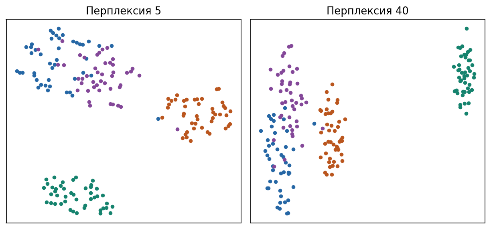
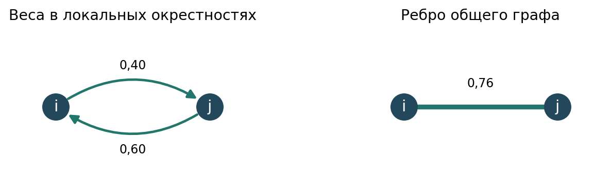

# 3. Снижение размерности и кластеризация


Пусть объекты заданы векторами $x_i\in\mathbb{R}^d$, $i=1,\ldots,n$. Когда $d$ велико, евклидовы расстояния теряют контраст, а оценка ковариации требует много наблюдений. Снижение размерности строит отображение $x\mapsto z\in\mathbb{R}^k$ при $k\ll d$, сохраняя выбранную структуру: дисперсию, разделимость классов или локальные соседства. Кластеризация ищет разбиение множества индексов $\{1,\ldots,n\}$ на группы без меток $y_i$.


## PCA: центрирование, максимум дисперсии, собственная задача


Данные заданы матрицей $X\in\mathbb{R}^{n\times d}$, в $i$-й строке лежит $x_i^\top$. Среднее по выборке


```math
\bar x=\frac1n\sum_{i=1}^{n}x_i\in\mathbb{R}^d.
```


Центрированные векторы $\tilde x_i=x_i-\bar x$ образуют матрицу $\tilde X\in\mathbb{R}^{n\times d}$ со строками $\tilde x_i^\top$. Без центрирования первая ось часто совпадает с направлением к среднему, а не с направлением наибольшей вариации.

Выборочная ковариация


```math
\Sigma=\frac1n\tilde X^\top\tilde X\in\mathbb{R}^{d\times d}
```


симметрична и неотрицательно определена. Для единичного направления $v\in\mathbb{R}^d$, $\|v\|_2=1$, дисперсия проекций $\tilde x_i^\top v$ равна


```math
\frac1n\sum_{i=1}^{n}(\tilde x_i^\top v)^2=v^\top\Sigma v.
```


Первая главная компонента решает задачу


```math
v_1=\arg\max_{\|v\|_2=1}v^\top\Sigma v.
```


Чтобы учесть ограничение $v^\top v=1$, вводят множитель Лагранжа $\lambda$ и функцию


```math
L(v,\lambda)=v^\top\Sigma v+\lambda(1-v^\top v).
```


Дифференцируют по $v$. Для симметричной $\Sigma$ верно $\nabla_v(v^\top\Sigma v)=2\Sigma v$ и $\nabla_v(v^\top v)=2v$, поэтому


```math
\nabla_v L=2\Sigma v-2\lambda v.
```


Условие стационарности $\nabla_v L=0$ есть


```math
\Sigma v=\lambda v.
```


Значит, кандидаты — собственные векторы $\Sigma$. На единичной сфере $v^\top\Sigma v=\lambda$, поэтому максимум дисперсии достигается на собственном векторе с наибольшим собственным числом $\lambda_1$. Это и есть $v_1$.

Следующие направления ищут среди векторов, ортогональных уже найденным, снова максимизируя $v^\top\Sigma v$. Они отвечают следующим по величине собственным числам $\lambda_2,\ldots,\lambda_k$. Матрица проекции на первые $k$ осей есть $V_k=[v_1,\ldots,v_k]$, а низкомерные координаты объекта $i$ равны $z_i=V_k^\top\tilde x_i$.


### Связь с SVD и теорема Эккарта–Янга


В лекции 1 сингулярное разложение произвольной матрицы $A\in\mathbb{R}^{n\times d}$ записывали как $A=U\Sigma V^\top$, где столбцы $U$ и $V$ ортонормированы, а $\Sigma$ диагональна с неотрицательными сингулярными числами $\sigma_1\ge\sigma_2\ge\ldots$. То же применяют к центрированной матрице данных:


```math
\tilde X=U\Sigma_{\mathrm{svd}}V^\top.
```


Столбцы $V$ диагонализуют $\tilde X^\top\tilde X$, поэтому главные направления PCA совпадают с правыми сингулярными векторами $\tilde X$. Собственные числа выборочной ковариации связаны с сингулярными числами формулой $\lambda_j=\sigma_j^2/n$. Проекция $\tilde X V_k$ есть сжатое представление ранга не выше $k$.

Теорема Эккарта–Янга утверждает, что среди всех матриц ранга не выше $k$ наилучшая аппроксимация $\tilde X$ в норме Фробениуса получается обрезкой SVD:

```math
A_k=\sum_{j=1}^{k}\sigma_j u_j v_j^\top,
\qquad
\|\tilde X-A_k\|_F^2=\sum_{j=k+1}^{r}\sigma_j^2,
```


где $r=\mathrm{rank}(\tilde X)$. Отбрасываемые сингулярные числа измеряют квадрат нормы потерянной части сигнала в смысле $\|\cdot\|_F$.

Что теряется при отбрасывании хвоста спектра. PCA сохраняет подпространство наибольшей полной дисперсии и отбрасывает ортогональное дополнение. Если полезный для предсказания сигнал лежит вдоль направления с малой дисперсией, соответствующая ось уйдёт вместе с шумом. PCA не использует метки классов и не обязан сохранять нелинейные многообразия или локальные соседства. Он описывает глобальную линейную структуру второго порядка.


## LDA: матрицы разброса и отношение Рэлея


Линейный дискриминантный анализ (Linear Discriminant Analysis, LDA) в задаче снижения размерности использует известные метки классов, чтобы выбрать оси проекции. Рассмотрим сначала одну ось. После проекции у объекта останется одно число $w^\top x_i$. Хотелось бы, чтобы по этому числу можно было различать классы. Большое расстояние между их средними помогает лишь тогда, когда разброс внутри каждого класса достаточно мал по сравнению с этим расстоянием. Пусть есть $C$ классов. Обозначим $I_c=\{i:y_i=c\}$ множество индексов класса $c$, $n_c=|I_c|$, и


```math
\mu_c=\frac1{n_c}\sum_{i\in I_c}x_i,
\qquad
\mu=\frac1n\sum_{i=1}^{n}x_i=\sum_{c=1}^{C}\frac{n_c}{n}\mu_c.
```


Внутриклассовая матрица разброса суммирует внешние произведения отклонений от среднего своего класса:


```math
S_W=\sum_{c=1}^{C}\sum_{i\in I_c}(x_i-\mu_c)(x_i-\mu_c)^\top\in\mathbb{R}^{d\times d}.
```


Межклассовая матрица разброса измеряет разброс средних классов относительно общего среднего:


```math
S_B=\sum_{c=1}^{C}n_c(\mu_c-\mu)(\mu_c-\mu)^\top\in\mathbb{R}^{d\times d}.
```


Для направления $w\in\mathbb{R}^d$ величина $w^\top S_W w$ есть сумма квадратов проекций внутриклассовых отклонений, а $w^\top S_B w$ — взвешенная сумма квадратов проекций отклонений средних. Обе величины зависят от масштаба $w$. Если удвоить $w$, каждая вырастет вчетверо, хотя направление проекции останется прежним. Поэтому сравнивают их отношение.

Для симметричной матрицы $A$ и ненулевого вектора $w$ **отношением Рэлея** называют $R_A(w)=(w^\top A w)/(w^\top w)$. Если $w$ — собственный вектор, то подстановка $Aw=\lambda w$ даёт $R_A(w)=\lambda$. В PCA знаменатель равнялся единице, потому что мы выбирали единичную ось. В LDA мерой масштаба служит разброс вдоль оси внутри классов. Когда в знаменателе стоит квадратичная форма $w^\top S_W w$, получается **обобщённое отношение Рэлея**. Критерий Фишера выбирает ось, на которой это отношение максимально


```math
J(w)=\frac{w^\top S_B w}{w^\top S_W w}
```


при условии $w^\top S_W w\neq 0$. Критерий однороден: $J(cw)=J(w)$ для $c\neq 0$, поэтому достаточно искать стационарные точки на уровне $w^\top S_W w=1$. Лагранжиан


```math
L(w,\lambda)=w^\top S_B w-\lambda(w^\top S_W w-1)
```


даёт $\nabla_w L=2S_B w-2\lambda S_W w=0$, то есть


```math
S_B w=\lambda S_W w.
```


Если $S_W$ обратима, это обычная собственная задача для $S_W^{-1}S_B$:


```math
S_W^{-1}S_B w=\lambda w.
```


Наибольшее $\lambda$ даёт первое дискриминантное направление. Следующие берут из следующих собственных векторов.

Матрица $S_B$ есть сумма не более $C$ внешних произведений векторов $(\mu_c-\mu)$, причём эти векторы линейно зависимы из-за тождества $\sum_c n_c(\mu_c-\mu)=0$. Поэтому $\mathrm{rank}(S_B)\le C-1$. Число положительных обобщённых собственных значений не превышает $C-1$, и полезных дискриминантных осей не больше $C-1$.

В отличие от PCA критерий явно тянет классы врозь и сжимает их внутри. Нужны метки и устойчивые оценки $S_W$, $S_B$. При малом $n_c$ или вырожденной $S_W$ обобщённая задача требует регуляризации, например замены $S_W$ на $S_W+\varepsilon I$.


## t-SNE: аффинности, ядро Стьюдента и KL


Цель t-SNE — построить точки $y_1,\ldots,y_n\in\mathbb{R}^k$ при малом $k$, обычно $k=2$ или $k=3$, так чтобы локальные соседства в исходном пространстве сохранялись на карте.

Зафиксируем точку $x_i$. Через $p(j\mid i)$ обозначим вероятность выбрать $x_j$ её соседом. Для этого каждой точке $x_j$ приписывают гауссовский вес с шириной $\sigma_i$, затем делят этот вес на сумму весов всех кандидатов.


```math
g_{ij}=e^{-\frac{\lVert x_i-x_j\rVert_2^2}{2\sigma_i^2}},
\qquad
p(j\mid i)=\frac{g_{ij}}{\displaystyle\sum_{k\neq i}g_{ik}},
\qquad j\neq i.
```


Точку исключают из числа её собственных соседей, поэтому $p(i\mid i)=0$. При фиксированном $i$ вероятности $p(j\mid i)$ образуют распределение по индексам $j$. Его энтропию $H_i$ и перплексию $P_i$ вычисляют по формулам

```math
H_i=-\sum_{j\ne i}p(j\mid i)\log_2\!\bigl(p(j\mid i)\bigr),
\qquad P_i=2^{H_i}.
```

Перплексия играет роль эффективного числа соседей: для равномерного распределения на $k$ соседях перплексия равна $k$. Задают целевую перплексию и подбирают $\sigma_i$, пока $P_i$ не совпадёт с ней.

Теперь построим **матрицу сходства объектов в исходном многомерном пространстве** $P=(p_{ij})$ размера $n\times n$. Её строка $i$ и столбец $j$ соответствуют объектам $x_i$ и $x_j$. Элемент $p_{ij}$ называют **симметричной совместной аффинностью** (*joint probability of similarity*). Он показывает, какая доля общей вероятностной массы приходится на упорядоченную пару $(i,j)$. Больший вес означает более тесное соседство.

Чтобы получить эту вероятность, сначала выберем исходную точку равновероятно из $n$ объектов, а затем выберем её соседа. Вероятность начать с $i$ и выбрать $j$ равна $\frac{1}{n}p(j\mid i)$. Для обратного порядка получаем $\frac{1}{n}p(i\mid j)$. Эти величины могут различаться, поскольку у каждой точки своя ширина окрестности. Присвоим обеим ячейкам $(i,j)$ и $(j,i)$ среднее двух вероятностей

```math
p_{ij}=p_{ji}
=\frac{1}{2}\left(\frac{p(j\mid i)}{n}+\frac{p(i\mid j)}{n}\right)
=\frac{p(j\mid i)+p(i\mid j)}{2n}.
```

Такое усреднение сохраняет суммарный вес каждой пары ячеек. Поэтому сумма по всей матрице остаётся равной единице, а на диагонали стоят нули. Далее t-SNE строит аналогичную матрицу $Q$ по точкам на карте и сравнивает её с $P$.

В низкомерном пространстве соседство моделируют ядром Стьюдента с одной степенью свободы:


```math
u_{ij}=\frac{1}{1+\lVert y_i-y_j\rVert_2^2},
\qquad
q_{ij}=\frac{u_{ij}}{\displaystyle\sum_{a\neq b}u_{ab}},
\qquad i\neq j.
```


Тяжёлые хвосты позволяют умеренно далёким на карте точкам иметь малую $q_{ij}$ без сильного штрафа и ослабляют эффект скучивания, когда многие пары претендуют на одно и то же место в центре карты.

Целевая функция — дивергенция Кульбака–Лейблера между $\{p_{ij}\}$ и $\{q_{ij}\}$:


```math
C(Y)=\mathrm{KL}(P\|Q)=\sum_{i\neq j}p_{ij}\log\frac{p_{ij}}{q_{ij}}.
```


Координаты $y_i$ оптимизируют градиентным спуском по $C$. Градиент притягивает пары с большим $p_{ij}$ и относительно малым $q_{ij}$ и отталкивает пары с малым $p_{ij}$ и большим $q_{ij}$.

Локальное против глобального. t-SNE согласует вероятности соседства, то есть локальную структуру. Глобальные расстояния между далёкими облаками на карте не обязаны отражать исходную метрику. Размеры пятен и зазоры между ними нельзя читать как плотности или истинные расстояния. Карта зависит от перплексии и инициализации. Координаты $y_i$ не предназначены как признаковое пространство для последующего обучения без отдельного обоснования.




Четыре цвета обозначают четыре группы, из которых сгенерированы 12-мерные точки. Метки в t-SNE не передавались. Слева при подборе ширины окрестности ориентиром служат пять эффективных соседей, справа — сорок. Сравните, как меняется соседство точек одного цвета. Расстояние между цветными группами на карте нельзя читать как расстояние между их средними в исходных данных.


## UMAP: граф соседей и роль визуализации


UMAP тоже строит низкомерную карту, но начинает с взвешенного графа ближайших соседей в исходном пространстве. Для каждой точки $x_i$ находят $k$ ближайших соседей. Локальный масштаб задают расстоянием до ближайшего соседа и шириной, согласованной с числом соседей. Получают ориентированные веса, близкие к вероятностям принадлежности ребра локальному многообразию, затем симметризуют их в неориентированный граф с весами $w_{ij}\in[0,1]$.



На рисунке показана одна пара точек. Расстояние между ними одинаково в обе стороны, но каждая точка оценивает соседа в своём локальном масштабе. Пусть из $i$ в $j$ получился вес $a=0{,}40$, а в обратную сторону — $b=0{,}60$. UMAP объединяет оценки по правилу $w_{ij}=a+b-ab$. Для этой пары получаем $0{,}40+0{,}60-0{,}24=0{,}76$. Теперь у пары один вес, который учитывает оба соседства.

В низкомерном пространстве на тех же парах задают второе семейство весов через гладкое убывающее ядро от $\|y_i-y_j\|_2$, зависящее от гиперпараметра минимального расстояния. Оптимизируют кросс-энтропийную стоимость по рёбрам: для существующих в высокомерном графе рёбер тянут $y_i$ и $y_j$ ближе, для отсутствующих — разводят. Тем самым согласуют две нечёткие топологии, а не две полные матрицы попарных вероятностей в духе t-SNE.

На практике UMAP часто устойчивее удерживает крупные разделения групп, чем t-SNE, и масштабируется на большие $n$. Оба метода прежде всего инструменты визуализации и разведочного анализа. Число соседей и минимальное расстояние меняют баланс локальной и глобальной структуры так же сильно, как перплексия в t-SNE. Координаты карты снова нельзя автоматически трактовать как евклидово признаковое пространство для обучения моделей.


## K-Means: функционал, шаги Ллойда, допущения


Задано число кластеров $K$. Ищут центроиды $c_1,\ldots,c_K\in\mathbb{R}^d$ и разбиение $S_1,\ldots,S_K$ множества $\{x_1,\ldots,x_n\}$, минимизирующие внутрикластерную сумму квадратов:


```math
J(S,c)
=\sum_{k=1}^{K}\sum_{x\in S_k}\|x-c_k\|_2^2.
```


Это дискретная задача: разбиение выбирается из конечного множества, центроиды непрерывны. При фиксированном разбиении оптимальный центроид кластера $S_k$ есть среднее его точек,


```math
c_k=\frac1{|S_k|}\sum_{x\in S_k}x,
```


если $S_k$ непусто. Это следует из условия $\nabla_{c_k}J=0$. При фиксированных центроидах оптимальное назначение кладёт каждую точку в ближайший центроид:


```math
S_k=\bigl\{x_i:\ \|x_i-c_k\|_2\le\|x_i-c_\ell\|_2\ \forall\ell\bigr\}.
```


Алгоритм Ллойда чередует эти два шага до стабилизации назначений. Функционал $J$ на каждом полном цикле не возрастает, потому что каждый шаг точен для своей половины переменных. Глобальный минимум не гарантирован. Ответ зависит от инициализации центроидов.

Геометрия критерия предполагает компактные, примерно сферические в евклидовой метрике кластеры сходного масштаба. Вытянутые формы, кластеры разной плотности и сильный шум меняют смысл разбиения: минимизация суммы квадратов всё равно что-то найдёт, но группы могут не совпадать с интуитивными областями плотности.


## DBSCAN: epsilon, minPts, ядро, граница, шум


Фиксируют радиус $\varepsilon>0$ и целое $\mathrm{minPts}\ge 1$. Для точки $x$ множество соседей


```math
N_\varepsilon(x)=\{x':\|x-x'\|_2\le\varepsilon\}.
```


Точка $x$ называется ядровой, если $|N_\varepsilon(x)|\ge\mathrm{minPts}$. Точка $y$ прямо плотность-достижима из ядровой $x$, если $y\in N_\varepsilon(x)$. Плотность-достижимость есть транзитивное замыкание прямых шагов по цепочке ядровых точек: из ядра можно перейти к соседу-ядру, затем снова, и так далее, присоединяя также граничные точки на последнем шаге.

Точка на границе кластера лежит в $\varepsilon$-окрестности некоторого ядра, но сама ядром не является. Точка, не плотность-достижимая ни из какого ядра, помечается как шум.

Кластер в DBSCAN есть максимальное по включению множество точек, связанных плотность-достижимостью из одного ядра, вместе с присоединёнными граничными точками. Число кластеров заранее не задают. Формы кластеров могут быть произвольными, пока плотность внутри связной компоненты достаточна относительно выбранных $\varepsilon$ и $\mathrm{minPts}$.

Один общий $\varepsilon$ задаёт одну шкалу плотности на весь набор. Если соседние группы имеют разную плотность, одним $\varepsilon$ их разделить устойчиво трудно: либо редкий кластер распадётся в шум, либо плотные области сольются.


## HDBSCAN: зачем переменная плотность


HDBSCAN снимает жёсткий выбор одного $\varepsilon$. Если в данных есть и густые, и разреженные группы, один радиус либо рвёт редкий кластер в шум, либо склеивает плотные области.

Идея: пробежать много масштабов плотности сразу. Сначала для каждой точки оценивают локальную плотность через расстояние до $k$-го соседа. Затем вводят взаимную достижимость: две точки считают тем ближе, чем плотнее область между ними относительно их локальных масштабов. По этой метрике строят минимальный остовный граф и из него — иерархию слияний плотностных компонент, как в агломеративной кластеризации, но по шкале плотности.

Из иерархии выбирают плоские кластеры по стабильности ветви: насколько долго ветвь существует при изменении масштаба. Долгоживущая ветвь предпочтительнее мимолётной. Точки вне выбранных ветвей остаются шумом. Вместо одного $\varepsilon$ появляется, например, минимальный размер кластера, но постановка уже допускает переменную плотность.


## Агломеративная кластеризация: связности и дендрограмма


Каждая точка стартует как отдельный кластер. На шаге $t$ есть разбиение на текущие кластеры. Выбирают пару кластеров с наименьшим расстоянием по выбранной связности и сливают их. Процесс повторяют, пока не останется один кластер или пока не достигнуто нужное число групп.

Пусть $A$ и $B$ — два кластера, $d(x,x')$ — попарное расстояние между объектами. Связности задают расстояние между кластерами:


```math
\begin{aligned}
d_{\mathrm{single}}(A,B)&=\min_{x\in A,\ x'\in B}d(x,x'),\\
d_{\mathrm{complete}}(A,B)&=\max_{x\in A,\ x'\in B}d(x,x'),\\
d_{\mathrm{average}}(A,B)&=\frac{1}{|A||B|}\sum_{x\in A}\sum_{x'\in B}d(x,x').
\end{aligned}
```


Single смотрит на ближайшую пару точек двух кластеров и склонен строить вытянутые цепочки. Complete смотрит на самую далёкую пару и предпочитает более компактные слияния. Average усредняет все попарные расстояния.

Связность Ward измеряет прирост внутрикластерной суммы квадратов при слиянии $A$ и $B$. Если $\mu_A$, $\mu_B$ — центроиды, а $|A|$, $|B|$ — размеры, прирост равен


```math
d_{\mathrm{Ward}}(A,B)
=\frac{|A||B|}{|A|+|B|}\|\mu_A-\mu_B\|_2^2.
```


Сливают пару с наименьшим приростом. Критерий родственен K-Means: оба смотрят на сумму квадратов до центроидов.

Историю слияний рисуют дендрограммой: по вертикали откладывают расстояние или стоимость слияния, по горизонтали — объекты. Горизонтальный разрез на выбранной высоте даёт плоское разбиение. Жадное слияние необратимо: ранняя ошибка не исправляется на следующих шагах. Выбор метрики $d$ и связности определяет геометрию ответа не меньше, чем сами данные.


## Источники


Идеи постановок PCA, LDA и кластеризации опираются на классические формулировки из ESL и на статьи вики machinelearning.ru:

- [Метод главных компонент](http://www.machinelearning.ru/wiki/index.php?title=%D0%9C%D0%B5%D1%82%D0%BE%D0%B4_%D0%B3%D0%BB%D0%B0%D0%B2%D0%BD%D1%8B%D1%85_%D0%BA%D0%BE%D0%BC%D0%BF%D0%BE%D0%BD%D0%B5%D0%BD%D1%82)
- [Линейный дискриминантный анализ](http://www.machinelearning.ru/wiki/index.php?title=%D0%9B%D0%B8%D0%BD%D0%B5%D0%B9%D0%BD%D1%8B%D0%B9_%D0%B4%D0%B8%D1%81%D0%BA%D1%80%D0%B8%D0%BC%D0%B8%D0%BD%D0%B0%D0%BD%D1%82%D0%BD%D1%8B%D0%B9_%D0%B0%D0%BD%D0%B0%D0%BB%D0%B8%D0%B7)
- [Кластеризация](http://www.machinelearning.ru/wiki/index.php?title=%D0%9A%D0%BB%D0%B0%D1%81%D1%82%D0%B5%D1%80%D0%B8%D0%B7%D0%B0%D1%86%D0%B8%D1%8F)
- Hastie, Tibshirani, Friedman, *The Elements of Statistical Learning*, главы о линейных методах и кластеризации
