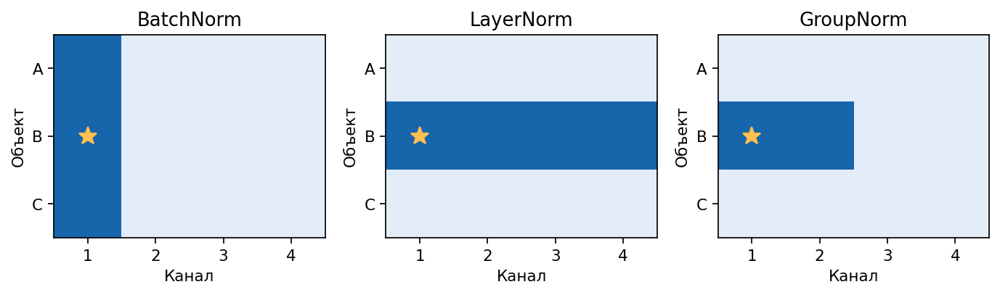

# 4. Глубокое обучение


Нейросеть — параметризованная композиция отображений. Все веса и смещения собирают в вектор параметров $\theta$. Обучение минимизирует эмпирический риск


```math
\hat{R}_n(\theta)=\frac1n\sum_{i=1}^{n}\ell\bigl(f_\theta(x_i),y_i\bigr).
```


## Градиентный спуск, мини-батч и обратное распространение


Полный градиентный спуск делает шаг


```math
\theta_{t+1}=\theta_t-\eta\nabla_\theta\hat{R}_n(\theta_t),
```


где градиент усреднён по всей обучающей выборке. При большом $n$ это дорого.

Стохастический градиентный спуск заменяет полный градиент градиентом по одному случайному объекту или по мини-батчу $\mathcal{B}_t$ из нескольких объектов:


```math
g_t=\frac1{|\mathcal{B}_t|}\sum_{i\in\mathcal{B}_t}\nabla_\theta\ell\bigl(f_\theta(x_i),y_i\bigr),
\qquad
\theta_{t+1}=\theta_t-\eta g_t.
```


Оценка $g_t$ шумная, но дешёвая. На практике почти всегда имеют в виду мини-батч SGD.

Обратное распространение ошибки — способ посчитать $\nabla_\theta\ell$ для композиции слоёв. Если сеть есть $f=f_L\circ\cdots\circ f_1$, цепное правило даёт произведение якобианов слоёв. На прямом проходе сохраняют промежуточные активации. На обратном проходе от потери к входу последовательно умножают локальные производные слоёв. Без цепного правила градиент глубокой сети пришлось бы писать вручную для каждой архитектуры.


## Многослойный перцептрон


Вход $x\in\mathbb{R}^{d_0}$. Слой с номером $\ell=1,\ldots,L$ вычисляет


```math
z^{(\ell)}=W^{(\ell)}h^{(\ell-1)}+b^{(\ell)},
\qquad
h^{(\ell)}=\phi\bigl(z^{(\ell)}\bigr),
```


где $h^{(0)}=x$, матрица $W^{(\ell)}\in\mathbb{R}^{d_\ell\times d_{\ell-1}}$, вектор $b^{(\ell)}\in\mathbb{R}^{d_\ell}$, а $\phi$ применяется поточечно.

Если на всех слоях $\phi$ тождественна, композиция линейных карт снова линейна:


```math
h^{(L)}=W^{(L)}\cdots W^{(1)}x+\text{аффинный член}.
```


Нелинейность $\phi$ нужна, чтобы сеть могла приближать функции вне класса аффинных отображений.

На выходе для регрессии часто стоит тождество. Для бинарной классификации ставят сигмоиду и BCE. Для $K$ классов ставят Softmax и категориальную кросс-энтропию. Откуда сигмоида и Softmax берутся в этих потерях, разобрано в главе о классическом ML: это обратные связи к линейной модели логитов в бернуллиевском и категориальном правдоподобии.


## Активации


$\mathrm{ReLU}(z)=\max(0,z)$. Производная равна $0$ при $z<0$ и $1$ при $z>0$. Положительная ветвь не насыщается. Если предактивация единицы всегда отрицательна на обучающих данных, градиент по её весам нулевой: единица «мертва».

LeakyReLU задаёт $z$ при $z\ge 0$ и $az$ при $z<0$ с малым $a\in(0,1)$, чтобы отрицательная ветвь сохраняла ненулевой градиент.

$\mathrm{GELU}(z)=z\,\Phi(z)$, где $\Phi$ — функция распределения $\mathcal{N}(0,1)$. Вход взвешивается гладко, без жёсткого обрезания.

$\mathrm{SiLU}(z)=z\,\sigma(z)$ совпадает со Swish. SwiGLU для входа $u$ использует две проекции:


```math
\mathrm{SwiGLU}(u)=\bigl(\mathrm{SiLU}(W_1 u)\bigr)\odot(W_2 u),
```


где $\odot$ — поэлементное умножение. Такую нелинейность ставят внутри двухслойного отображения, которое применяют к каждому токену отдельно в блоке трансформера. При том же числе параметров вентильная структура обычно выразительнее обычного $\mathrm{ReLU}$ или $\mathrm{GELU}$ между двумя линейными слоями.

Логистическая сигмоида $\sigma(z)=\frac{1}{1+e^{-z}}$ и гиперболический тангенс насыщаются на хвостах: $\sigma'(z)\to 0$ при $|z|\to\infty$. Произведение многих таких множителей в глубокой сети гасит градиент.

Softmax на логитах $z\in\mathbb{R}^K$:


```math
\mathrm{softmax}(z)_k=\frac{e^{z_k}}{\sum_{j=1}^{K}e^{z_j}}.
```


Это каноническая связь категориального распределения: линейная модель логитов переводится в точку на симплексе вероятностей.


## Инициализация Xavier и He


Пусть слой считает $z=Wh$ при независимости координат $h$ и нулевом среднем весов. Дисперсия одной координаты $z$ равна $n_{\mathrm{in}}\cdot\mathrm{Var}(W_{ij})\cdot\mathrm{Var}(h_j)$ в простейшей оценке.

Инициализация Xavier, известная также как Glorot, подбирает $\mathrm{Var}(W)$ так, чтобы дисперсия сигнала сохранялась и при прямом, и при обратном проходе для симметричных активаций вроде $\tanh$:


```math
\mathrm{Var}(W_{ij})=\frac{2}{n_{\mathrm{in}}+n_{\mathrm{out}}}.
```


Инициализация He, известная также как Kaiming, учитывает, что ReLU обнуляет примерно половину массы активаций, и ставит


```math
\mathrm{Var}(W_{ij})=\frac{2}{n_{\mathrm{in}}}.
```


Слишком малая дисперсия гасит сигнал по глубине. Слишком большая взрывает активации и градиенты.


## Нормализация

Пусть $u$ обозначает вектор исходных активаций слоев до нормирования (вход метода), а $y$ — итоговый нормализованный и масштабированный вектор на выходе слоя нормализации.

**BatchNorm** для вектора активаций по мини-батчу размера $B$ в фиксированной координате считает

```math
\hat u_i=\frac{u_i-\mu_B}{\sqrt{\sigma_B^2+\varepsilon}}, \qquad y_i=\gamma\hat u_i+\beta,
```

где $\mu_B$ и $\sigma_B^2$ — среднее и дисперсия по батчу, а $\gamma$, $\beta$ обучаемы. На применении уже обученной модели, когда батч может быть размера один, $\mu$ и $\sigma$ заменяют накопительной оценкой, собранной во время обучения. BatchNorm зависит от размера и состава батча.

**LayerNorm** для каждого отдельного примера нормирует активации, выходы нейронов, по всем признакам этого слоя: среднее и дисперсия берутся внутри примера, не по батчу. Для признаков размерности $d$ одного объекта формулы имеют вид

```math
\mu_L = \frac1d\sum_{j=1}^{d}u_j, \qquad \sigma_L^2 = \frac1d\sum_{j=1}^{d}(u_j - \mu_L)^2,
```

```math
\hat u_j = \frac{u_j - \mu_L}{\sqrt{\sigma_L^2 + \varepsilon}}, \qquad y_j = \gamma \hat u_j + \beta.
```

Поэтому LayerNorm устойчив к малому батчу и к переменной длине последовательности.

**RMSNorm** опускает вычитание среднего и делит на

```math
\mathrm{RMS}(u)=\sqrt{\frac1d\sum_{j=1}^{d}u_j^2+\varepsilon},
```

а итоговое преобразование на выходе использует только масштабирование:

```math
y_j = \gamma \frac{u_j}{\mathrm{RMS}(u)}.
```

**GroupNorm** делит каналы на группы и нормирует статистикой внутри группы одного примера. Если $d$ признаков (каналов) разбиты на $G$ групп, то для признака $j$, входящего в группу $S_g$ размера $m = d/G$, вычисляются:

```math
\mu_G = \frac1m\sum_{k \in S_g}u_k, \qquad \sigma_G^2 = \frac1m\sum_{k \in S_g}(u_k - \mu_G)^2,
```

```math
\hat u_j = \frac{u_j - \mu_G}{\sqrt{\sigma_G^2 + \varepsilon}}, \qquad y_j = \gamma \hat u_j + \beta.
```

Метод устойчив при малом батче в свёрточных сетях.



Строка — объект, столбец — канал. Звёздочкой отмечен элемент, для которого считаем среднее и дисперсию по синим ячейкам. Здесь у каждого канала одно значение на объект, а для GroupNorm четыре канала разделены на две группы.


## Dropout


На обучении каждая активация умножается на независимую бернуллиевскую маску: с вероятностью $p$ становится нулём, иначе делится на $1-p$, чтобы сохранить математическое ожидание. На инференсе маску выключают. Dropout приближает обучение ансамбля прореженных подсетей и снижает коадаптацию признаков.


## Оптимизаторы

### SGD

Пусть $\theta_{t-1}$ — веса перед шагом $t$, а $B_t$ — выбранный на этом шаге мини-батч. Для каждого объекта $i$ считаем производную его потери $\ell_i$ по весам и усредняем по объектам батча. При скорости обучения $\eta_t>0$ получаем шаг SGD

```math
g_t=\frac{1}{|B_t|}\sum_{i\in B_t}\nabla\ell_i(\theta_{t-1}),
\qquad \theta_t=\theta_{t-1}-\eta_t g_t.
```

Ниже у всех методов один и тот же вход $g_t$. Они по-разному используют историю предыдущих шагов. Накопители начинаются с нуля. Квадрат, квадратный корень и деление в векторных формулах применяются к каждой координате отдельно. Малое $\varepsilon>0$ защищает от деления на ноль.

### Momentum

Если градиент несколько шагов подряд направлен в одну сторону, можно накапливать движение в этом направлении. Обозначим накопитель через $u_t$, а долю сохранённого прошлого шага через $0\le\beta<1$. Подставляя рекурсию в саму себя, получаем веса всех прошлых градиентов

```math
u_t=\beta u_{t-1}+g_t
=\sum_{s=1}^{t}\beta^{t-s}g_s,
\qquad \theta_t=\theta_{t-1}-\eta_t u_t.
```

Когда знак производной постоянно меняется, соседние слагаемые частично гасят друг друга. Когда знак сохраняется, они складываются.

### AdaGrad

Рассмотрим координату $j$, например вес редкого признака. Сохраним в $s_{t,j}$ сумму квадратов всех производных по этому весу. Чем больше эта сумма, тем меньше множитель перед следующим обновлением координаты

```math
s_{t,j}=s_{t-1,j}+g_{t,j}^2,
\qquad
\theta_{t,j}=\theta_{t-1,j}
-\frac{\eta_t}{\sqrt{s_{t,j}}+\varepsilon}\,g_{t,j}.
```

Если производная равна одному и тому же $g\ne0$ на каждом шаге, то $s_{t,j}=tg^2$. При постоянной $\eta$ и пренебрежимо малом $\varepsilon$ величина шага равна $\eta/\sqrt{t}$. У редко активной координаты сумма растёт лишь на шагах с ненулевой производной.

### RMSProp

У AdaGrad большой градиент, встретившийся в начале обучения, навсегда остаётся в знаменателе. RMSProp даёт прошлым квадратам постепенно убывающие веса. Для коэффициента памяти $0\le\rho<1$ базовый шаг имеет вид

```math
s_t=\rho s_{t-1}+(1-\rho)g_t^2,
\qquad
\theta_t=\theta_{t-1}-\eta_t\frac{g_t}{\sqrt{s_t}+\varepsilon}.
```

При постоянном $g$ накопитель равен $(1-\rho^t)g^2$ и приближается к $g^2$. Поэтому одна лишь длина истории уже не заставляет шаг стремиться к нулю.

### Adam

RMSProp сглаживает квадрат градиента. Adam сглаживает также сам градиент, сохраняя его знак. Коэффициенты $\beta_1$ и $\beta_2$ задают память двух накопителей

```math
m_t=\beta_1m_{t-1}+(1-\beta_1)g_t,
\qquad
v_t=\beta_2v_{t-1}+(1-\beta_2)g_t^2.
```

При нулевой инициализации сумма весов в первом среднем равна $(1-\beta_1)\sum_{s=0}^{t-1}\beta_1^s=1-\beta_1^t$. Во втором получается такое же выражение с $\beta_2$. Деление на эти суммы устраняет начальное занижение средних

```math
\hat m_t=\frac{m_t}{1-\beta_1^t},
\qquad \hat v_t=\frac{v_t}{1-\beta_2^t},
\qquad \theta_t=\theta_{t-1}-\eta_t\frac{\hat m_t}{\sqrt{\hat v_t}+\varepsilon}.
```

### AdamW

У штрафа $\lambda\lVert\theta\rVert_2^2/2$ градиент равен $\lambda\theta$. В SGD его добавление даёт $\theta-\eta(g+\lambda\theta)=(1-\eta\lambda)\theta-\eta g$. В Adam подстановка $g+\lambda\theta$ меняет оба накопителя, поэтому такого разложения уже нет. AdamW считает $\hat m_t$ и $\hat v_t$ по градиенту потери, как в Adam, а веса сжимает отдельным множителем

```math
\theta_t=(1-\eta_t\lambda)\theta_{t-1}
-\eta_t\frac{\hat m_t}{\sqrt{\hat v_t}+\varepsilon}.
```

Две координаты с одинаковым весом получают одинаковую поправку от сжатия, даже если их градиенты имели разный масштаб.

### Lion

Lion хранит одно скользящее среднее $m$. Для текущего шага он смешивает старое среднее со свежим градиентом и берёт знак по каждой координате. Для следующего шага он обновляет память с отдельным коэффициентом

```math
c_t=\beta_1 m_{t-1}+(1-\beta_1)g_t,
\qquad \theta_t=(1-\eta_t\lambda)\theta_{t-1}-\eta_t\mathrm{sign}(c_t),
```

```math
m_t=\beta_2m_{t-1}+(1-\beta_2)g_t.
```

Каждая координата с ненулевым $c_{t,j}$ получает от градиентной части шаг величины $\eta_t$. При $\lambda=0$ сжатие весов отключено.

### Adafactor

Пусть слой хранит матрицу $W$ из $h$ строк и $d$ столбцов, а $G_t$ — её градиент. В Adam второй момент требует ещё $hd$ чисел. Adafactor оценивает его по средним квадратам в каждой строке и каждом столбце. Обозначим $S_{ij}=G_{t,ij}^2+\varepsilon_1$, где $\varepsilon_1>0$ — малая константа, а $\rho_t$ — коэффициент памяти. Тогда

```math
r_{t,i}=\rho_t r_{t-1,i}+(1-\rho_t)\frac{1}{d}\sum_{j=1}^{d}S_{ij},
\qquad
c_{t,j}=\rho_t c_{t-1,j}+(1-\rho_t)\frac{1}{h}\sum_{i=1}^{h}S_{ij}.
```

Пусть $\bar r_t$ — среднее по всем $h$ строкам. Оно равно среднему по всем столбцам, поскольку оба способа усредняют одни и те же числа. Приближение $\widehat V_{t,ij}=r_{t,i}c_{t,j}/\bar r_t$ сохраняет нужные средние по строкам и столбцам. Для хранения достаточно $h+d$ чисел.

```math
U_{ij}=\frac{G_{t,ij}}{\sqrt{\widehat V_{t,ij}}},
\qquad W_t=W_{t-1}-\eta_t\frac{U}{\max(1,\mathrm{RMS}(U)/D)}.
```

Здесь $\mathrm{RMS}(U)=\sqrt{\sum_{ij}U_{ij}^2/(hd)}$, а $D>0$ — порог. Если среднеквадратичная величина обновления превышает $D$, весь шаг пропорционально уменьшают. Записан вариант без первого момента, $\eta_t$ обозначает уже выбранный для слоя шаг.

### Muon

Для матрицы весов скрытого слоя Muon обрабатывает направление обновления как целую матрицу. Сначала накапливают матричный импульс $M_t$. В варианте с ускорением Нестерова текущий градиент подмешивают ещё раз перед преобразованием направления

```math
M_t=\beta M_{t-1}+(1-\beta)G_t,
\qquad H_t=(1-\beta)G_t+\beta M_t.
```

Чтобы понять преобразование, запишем компактное сингулярное разложение по ненулевым сингулярным числам $H_t=U\Sigma V^\top$. Идеальное направление шага — $UV^\top$. Например, если на диагонали $\Sigma$ стоят 10 и 1, обе пары сингулярных векторов сохранят свои направления, а их множители станут равны 1. Полное разложение на каждом шаге обучения обходилось бы дорого.

В реализации Muon направление приближают несколькими матричными итерациями Ньютона — Шульца. Стартуют с $X_0=H_t/(\lVert H_t\rVert_F+\varepsilon)$. Для высокой матрицы можно сначала транспонировать её, а в конце вернуть исходную ориентацию. Один шаг используемой полиномиальной итерации имеет вид

```math
A_k=X_kX_k^\top,
\qquad X_{k+1}=aX_k+(bA_k+cA_k^2)X_k.
```

В опубликованном варианте $a=3{,}4445$, $b=-4{,}7750$, $c=2{,}0315$. После нескольких итераций получаем приближённое направление $O_t$. Его сингулярные числа могут отличаться от единицы. С учётом сжатия весов матричный шаг записывается как

```math
W_t=(1-\eta_t\lambda)W_{t-1}-\eta_t s\,O_t.
```

Здесь $s$ — множитель масштаба матрицы. В авторской реализации для слоя формы $h\times d$ используется $s=\sqrt{\max(1,h/d)}$. При $\lambda=0$ остаётся только шаг по матричному направлению. В исходной схеме для эмбеддингов, выходного слоя и одномерных параметров используют отдельный оптимизатор, обычно AdamW.


## RNN, LSTM и GRU


Последовательность $x_1,\ldots,x_T$ обрабатывают рекуррентно:


```math
h_t=\phi(W_h h_{t-1}+W_x x_t+b).
```


Градиент функции потерь по раннему состоянию $h_0$ по цепному правилу проходит через произведение якобианов


```math
\frac{\partial h_T}{\partial h_0}
=\prod_{t=1}^{T}\frac{\partial h_t}{\partial h_{t-1}}.
```


Если спектральные нормы множителей стабильно меньше единицы, норма произведения падает экспоненциально с $T$: градиент затухает. Если стабильно больше единицы — взрывается.

LSTM вводит клетку памяти $c_t$ и вентили. Все вентили — сигмоиды от аффинного преобразования конкатенации $[h_{t-1},x_t]$:


```math
f_t=\sigma(W_f[h_{t-1},x_t]+b_f),
\qquad
i_t=\sigma(W_i[h_{t-1},x_t]+b_i),
\qquad
o_t=\sigma(W_o[h_{t-1},x_t]+b_o),
```


```math
\tilde{c}_t=\tanh(W_c[h_{t-1},x_t]+b_c).
```


Forget-gate $f_t$ решает, что сохранить из $c_{t-1}$. Input-gate $i_t$ и кандидат $\tilde{c}_t$ решают, что записать. Output-gate $o_t$ решает, что прочитать в $h_t$:


```math
c_t=f_t\odot c_{t-1}+i_t\odot\tilde{c}_t,
\qquad
h_t=o_t\odot\tanh(c_t).
```


Ключевое отличие от простой RNN: обновление $c_t$ аддитивно по прошлой клетке. Вдоль пути $c_{t-1}\to c_t$ множитель есть $f_t$, а не произведение насыщающихся нелинейностей всей рекурсии. Если forget-gate близок к единице, градиент по времени проходит почти без затухания.

GRU объединяет forget и input в один update-gate $z_t$ и вводит reset-gate $r_t$ без отдельной клетки $c_t$:


```math
h_t=(1-z_t)\odot h_{t-1}+z_t\odot\tilde{h}_t,
```


где кандидат $\tilde{h}_t$ зависит от $r_t\odot h_{t-1}$. Параметров меньше, чем у LSTM, путь градиента снова аддитивный по $h_{t-1}$.

Рекурсия по $t$ последовательна и плохо параллелится по длине. В следующей лекции разбирается self-attention: там все позиции смешанно взаимодействуют без пошаговой рекурсии, ценой памяти порядка $n^2$.


## Источники


- Goodfellow, Bengio, Courville. Deep Learning
- He et al. Deep Residual Learning for Image Recognition. CVPR 2016
- Ioffe, Szegedy. Batch Normalization. ICML 2015
- Ba, Kiros, Hinton. Layer Normalization. 2016
- Kingma, Ba. Adam. ICLR 2015
- Loshchilov, Hutter. Decoupled Weight Decay Regularization. ICLR 2019
- Hochreiter, Schmidhuber. Long Short-Term Memory. Neural Computation 1997
