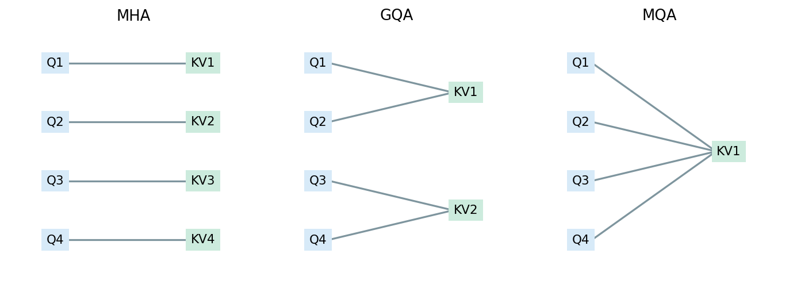
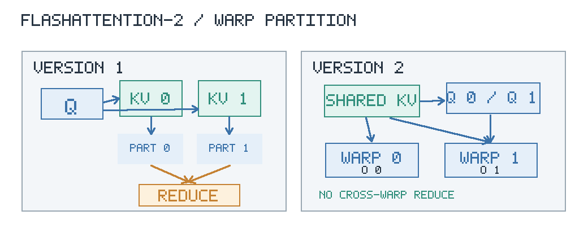
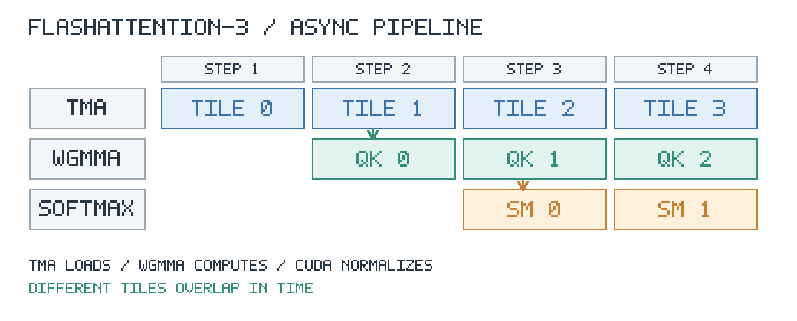
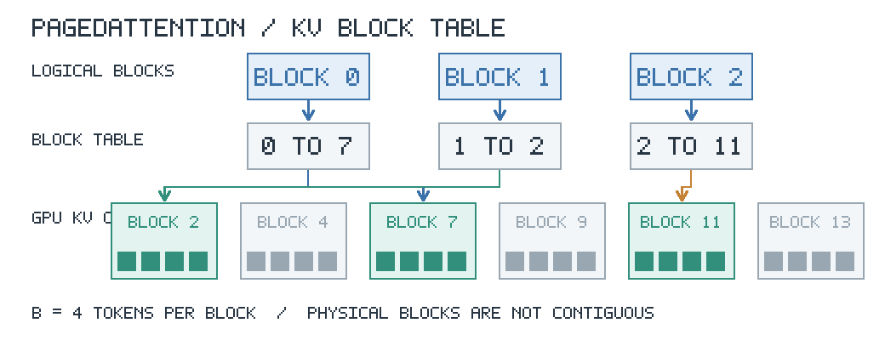
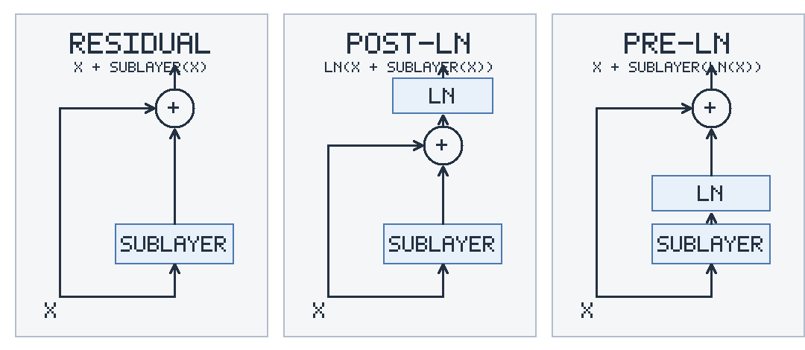

# 5. Трансформеры


Текст сначала режут на дискретные единицы — токены: слова, куски слов или байтовые фрагменты из фиксированного словаря. Каждому токену сопоставляют строку обучаемой таблицы эмбеддингов. На выходе получается упорядоченная последовательность векторов. Ниже фиксируются обозначения, затем выводится scaled dot-product attention, многоголовость, IO-aware реализации, позиционные сигналы и устройство блока.


## Вход и проекции Q, K, V


Пусть длина последовательности равна $n$, а размерность скрытого пространства модели равна $d$. Матрица входа


```math
X\in\mathbb{R}^{n\times d}
```


имеет в $i$-й строке вектор токена на позиции $i$. Индекс строки пробегает $\{1,\ldots,n\}$.

Self-attention строит для каждой позиции запрос, ключ и значение линейными отображениями:


```math
Q=XW_Q,\qquad K=XW_K,\qquad V=XW_V,
```


где $W_Q,W_K\in\mathbb{R}^{d\times d_k}$, $W_V\in\mathbb{R}^{d\times d_v}$. Обычно на одной голове берут $d_v=d_k$. Строка $q_i\in\mathbb{R}^{d_k}$ читается как «что позиция $i$ ищет среди остальных». Строка $k_j\in\mathbb{R}^{d_k}$ читается как «что позиция $j$ предлагает для сравнения». Строка $v_j\in\mathbb{R}^{d_v}$ читается как «какое содержание отдаст позиция $j$, если её выбрали».


## Почему делят на корень из d_k


Совместимость позиций $i$ и $j$ берут как скалярное произведение $\langle q_i,k_j\rangle$. Матрица всех совместимостей равна $QK^\top\in\mathbb{R}^{n\times n}$.

Пусть координаты $q$ и $k$ независимы, имеют нулевое среднее и единичную дисперсию. Тогда


```math
\langle q,k\rangle=\sum_{\ell=1}^{d_k}q_\ell k_\ell.
```


Дисперсия суммы независимых слагаемых равна сумме дисперсий:


```math
\mathrm{Var}(\langle q,k\rangle)=\sum_{\ell=1}^{d_k}\mathrm{Var}(q_\ell k_\ell)=d_k,
```


потому что для центрированных независимых координат $\mathrm{Var}(q_\ell k_\ell)=\mathrm{Var}(q_\ell)\mathrm{Var}(k_\ell)=1$. Без масштабирования типичная величина логита растёт как $\sqrt{d_k}$. Softmax от больших по модулю логитов почти вырождается в one-hot: производная по невыбранным позициям исчезает, обучение замирает.

Деление на $\sqrt{d_k}$ возвращает дисперсию логита к порядку единицы:


```math
\mathrm{Var}\Bigl(\frac{\langle q,k\rangle}{\sqrt{d_k}}\Bigr)=1.
```


Отсюда формула scaled dot-product attention:


```math
\mathrm{Attention}(Q,K,V)=\mathrm{softmax}\Bigl(\frac{QK^\top}{\sqrt{d_k}}\Bigr)V.
```


Обозначим


```math
P=\mathrm{softmax}\Bigl(\frac{QK^\top}{\sqrt{d_k}}\Bigr)\in\mathbb{R}^{n\times n}.
```


Каждая строка $P$ есть распределение по ключам. Строка $i$ выхода равна $\sum_{j=1}^{n}P_{ij}v_j$ и потому является выпуклой комбинацией строк $V$.

До softmax накладывают маску. Авторегрессия — режим, в котором следующий токен предсказывают только по уже известному левому контексту. Каузальная маска запрещает позиции $j>i$, чтобы позиция $i$ не видела будущее. Padding-маска обнуляет фиктивные позиции заполнения, которыми выравнивают последовательности разной длины в одном батче.


## Multi-Head Attention


Одна голова сравнивает позиции в одном линейном подпространстве. Multi-Head Attention считает $h$ голов независимо. Для головы с номером $i$


```math
\mathrm{head}_i=\mathrm{Attention}\bigl(QW_Q^{(i)},KW_K^{(i)},VW_V^{(i)}\bigr),
```


где $W_Q^{(i)},W_K^{(i)}\in\mathbb{R}^{d\times d_k}$, $W_V^{(i)}\in\mathbb{R}^{d\times d_v}$ и обычно $d_k=d_v=d/h$. Выходы склеивают и снова проецируют:


```math
\mathrm{MHA}(X)=\mathrm{Concat}(\mathrm{head}_1,\ldots,\mathrm{head}_h)W_O,
```


где $W_O\in\mathbb{R}^{h d_v\times d}$. Разные головы специализируются на разных типах зависимостей: синтаксических, позиционных, словарных.


## MQA и GQA: что разделяют и память KV


При пошаговой генерации на шаге $t$ снова нужны ключи и значения всех прошлых позиций $1,\ldots,t-1$. Их не пересчитывают: сохраняют в KV-кэше. Новый токен дописывает одну строку ключа и одну строку значения на слой. Объём кэша пропорционален числу слоёв, длине контекста, размерности головы и числу KV-голов. Подробный разбор фаз prefill и decoding — в следующей лекции. Здесь важен только факт: память растёт с числом KV-голов.

Multi-Query Attention оставляет отдельные матрицы запросов на каждую из $h$ голов, но использует одни и те же ключи и значения для всех голов. Число KV-голов равно $1$. Объём кэша падает примерно в $h$ раз относительно полной MHA.

Grouped-Query Attention занимает промежуток. Головы запросов делят на $g$ групп, $1\le g\le h$. Каждая группа имеет свои ключи и значения. При $g=h$ схема совпадает с MHA. При $g=1$ схема совпадает с MQA. На пошаговой генерации выигрыш идёт через объём читаемого кэша. На обработке всего промпта сразу число арифметических операций меняется слабо: доминирует чтение и запись памяти KV.




Проследите линии от Q1 и Q2. В MHA у каждой головы свой набор ключей и значений, в показанном GQA обе читают один набор, в MQA тот же набор читают все четыре. Запросы у голов остаются разными.


## FlashAttention: HBM, SRAM, тайлинг, online softmax


Обычный attention сначала вычисляет $S=QK^\top/\sqrt{d_k}$, затем $P=\mathrm{softmax}(S)$ и $O=PV$. При длине последовательности $n$ обе промежуточные матрицы имеют размер $n\times n$. Например, при $n=8192$ одна матрица в FP16 занимает 128 МиБ на голову. Её приходится записывать в HBM и снова читать для следующей операции.

HBM — глобальная память GPU, SRAM — быстрая память на чипе. FlashAttention обрабатывает небольшие части матриц в SRAM и не сохраняет полный $P$ в HBM. При этом количество скалярных произведений не сокращается: для плотного attention сложность остаётся $O(n^2d_k)$ при $d_k=d_v$.

### FlashAttention-1

Разобьём $Q$ на блоки по $B_r$ строк, а $K,V$ на блоки по $B_c$ строк. Для фиксированного блока запросов $Q_i$ будем последовательно читать блоки ключей и значений $K_j,V_j$. На каждом шаге получается небольшая матрица логитов

```math
S_{ij}=\frac{Q_iK_j^\top}{\sqrt{d_k}}\in\mathbb{R}^{B_r\times B_c}.
```

Считать softmax отдельно для каждого тайла нельзя, поскольку знаменатель зависит от всех ключей. Для каждой строки будем хранить текущий максимум логитов $m$, сумму экспонент $\ell$ и взвешенную сумму значений $a$. Начальные значения равны $m=-\infty$, $\ell=0$, $a=0$.

Пусть пришёл новый блок логитов $s'$ со значениями $v'_j$. Сначала обновим максимум:

```math
m_{\mathrm{new}}=\max(m,\max_j s'_j),\qquad
\alpha=e^{m-m_{\mathrm{new}}}.
```

Суммы, накопленные по старым ключам, были рассчитаны относительно $m$. Чтобы учесть новый максимум, умножим их на $\alpha$ и добавим вклад текущего блока:

```math
\ell_{\mathrm{new}}=\alpha\ell+\sum_j e^{s'_j-m_{\mathrm{new}}},
```

```math
a_{\mathrm{new}}=\alpha a+\sum_j e^{s'_j-m_{\mathrm{new}}}v'_j.
```

После последнего блока получим $o=a/\ell$. Это обычный softmax attention с другим порядком операций, поэтому различия возможны из-за округления. Каузальную маску накладывают на логиты до вычисления максимума.

Полную матрицу вероятностей теперь хранить не требуется. На backward тайлы логитов вычисляют повторно, используя сохранённые выход и статистики нормировки. Дополнительная память для attention уменьшается с $O(n^2)$ до $O(n)$ на статистики по строкам. В двухуровневой модели памяти с быстрой памятью размером $M$ элементов обмены оцениваются как $O(n^2d^2/M)$ при $d_k=d_v=d$ и подходящих размерах тайлов. Выигрыш связан с меньшим числом обращений к HBM, а не с уменьшением числа умножений.

### FlashAttention-2

В первой версии один блок запросов последовательно проходит по блокам ключей. Когда батч мал и голов немного, таких независимых задач может не хватить для загрузки всех мультипроцессоров. Во второй версии число независимо вычисляемых блоков определяется разбиением запросов:

```math
N_{\mathrm{blocks}}=
B_{\mathrm{batch}}\,h\left\lceil\frac{n}{B_r}\right\rceil,
```

где $h$ — число голов, а $B_{\mathrm{batch}}$ — размер батча. Каждый блок обрабатывает свои строки $Q$ и проходит по нужным блокам $K,V$. Такое разбиение позволяет загрузить больше мультипроцессоров при длинных последовательностях.

Меняется распределение работы между варпами одного блока. В FlashAttention-1 варпы считали разные части $K,V$ для общих запросов, поэтому их частичные результаты приходилось объединять через shared memory. В FlashAttention-2 каждому варпу дают собственные строки $Q$, а блоки $K,V$ переиспользуют:



Сокращаются обмены между варпами и синхронизации. Отдельно уменьшают число операций, не выполняемых на Tensor Cores. Вместо постоянной нормировки накопленного выхода можно вести ненормированную сумму $a$ и нормировать её один раз после последнего блока:

```math
a_{\mathrm{new}}=\alpha a+\sum_j e^{s'_j-m_{\mathrm{new}}}v'_j,
\qquad o=\frac{a}{\ell}.
```

Обновлять $m$ и $\ell$ всё равно необходимо, иначе softmax станет некорректным. Оптимизация состоит в том, что деление накопленного выхода на $\ell$ не повторяется после каждого тайла. Вычислительная сложность и результат attention остаются прежними.


### FlashAttention-3

На Hopper доступны асинхронные TMA для передачи тайлов в shared memory и WGMMA для матричных умножений. В FlashAttention-2 очередной тайл в основном проходит стадии последовательно: загрузка $K_j,V_j$, вычисление $Q_iK_j^\top$, softmax, умножение вероятностей на $V_j$. FlashAttention-3 организует их как конвейер. Пока Tensor Cores считают матричное умножение одного тайла, другие варпы загружают данные и обрабатывают softmax соседнего.



Это схема заполнения конвейера, а не точное расписание инструкций. В частности, следующий WGMMA может выполняться одновременно с softmax предыдущего тайла (*warp specialization*). Без перекрытия две стадии занимали бы примерно $T_{\mathrm{GEMM}}+T_{\mathrm{softmax}}$. При достаточном числе тайлов время установившейся стадии приближается к

```math
T_{\mathrm{stage}}\approx
\max(T_{\mathrm{GEMM}},T_{\mathrm{softmax}}),
```

если зависимости и обмен данными не мешают перекрытию. Это не оценка времени всего attention: начало и конец конвейера, а также загрузки памяти добавляют задержки.

Для FP8 есть отдельная проблема. При вычислении $P_j=\exp(S_j-m_j)$ значения $P_j$ могут различаться на много порядков, а FP8 имеет ограниченный диапазон. Поэтому в низкоточном пути применяют масштабирование и перестановку порядка операций (*incoherent processing*), уменьшающую ошибки квантования. Вычисление в FP8 уже не эквивалентно FP16/BF16 только с другим порядком округления.

FlashAttention-3 сохраняет тайлинг и online softmax. Ускорение даёт перекрытие работы Tensor Cores с передачей данных и нормировкой, а не уменьшение числа пар запрос–ключ.


## PagedAttention


При пошаговой генерации KV-кэш растёт на один токен за шаг. Если заранее выделить каждому запросу непрерывный буфер под максимальную длину контекста, часть памяти останется пустой. Кроме того, запросы заканчиваются в разное время, и свободные участки памяти оказываются разбросаны между занятыми.

PagedAttention в vLLM хранит KV-кэш блоками по $B$ токенов. У каждого запроса есть таблица, которая сопоставляет номер логического блока с номером физического блока GPU. Для позиции $t$, считая с нуля, адрес определяется как

```math
b=\left\lfloor\frac{t}{B}\right\rfloor,\qquad
r=t\bmod B,\qquad
\mathrm{address}(t)=(\mathrm{table}[b],r).
```

Например, если логические блоки одного запроса ссылаются на физические блоки $[7,2,11]$, то при $B=4$ токены $0,\ldots,3$ лежат в блоке 7, токены $4,\ldots,7$ — в блоке 2, а следующие — в блоке 11. Физически блоки не обязаны идти подряд.



Для последовательности длины $n$ потребуется $\lceil n/B\rceil$ блоков. Неиспользованными останутся не более $B-1$ мест под токены в последнем блоке каждого запроса, а не весь заранее выделенный запас под максимальный контекст. При генерации выделяют новый блок только после заполнения предыдущего. Сами вычисления attention по-прежнему читают все разрешённые ключи и значения, но находят их через таблицу блоков.

Блоки KV можно также разделять между запросами с общим префиксом, учитывая число ссылок и выделяя новые блоки при расхождении продолжений. Это важно для параллельных вариантов генерации. Continuous batching решает другую задачу: добавляет новые запросы в работающий батч по мере освобождения ресурсов. Вместе эти механизмы позволяют обслуживать последовательности разной длины с меньшими потерями памяти.


## Кодирование позиций


Self-attention без позиционного сигнала перестановочно эквивариантен. Пусть $\Pi$ — матрица перестановки строк. Тогда

```math
(\Pi X)W_Q=\Pi Q,\qquad (\Pi X)W_K=\Pi K,
```

и

```math
(\Pi Q)(\Pi K)^\top=\Pi(QK^\top)\Pi^\top.
```

Softmax по строкам сохраняет перестановку, поэтому при перестановке входных токенов выходные векторы переставляются тем же образом. Само внимание не различает последовательности с одинаковыми токенами, расположенными в разном порядке. Чтобы учитывать порядок, нужно явно передать информацию о позициях.

В абсолютном кодировании к эмбеддингу токена $x_i$ добавляют позиционный вектор $p_i$:

```math
\widetilde{x}_i=x_i+p_i.
```

Вектор $p_i$ может быть обучаемым. В исходном Transformer использовались синусоидальные векторы, где для пары координат $2k,2k+1$

```math
p_{i,2k}=\sin\left(\frac{i}{10000^{2k/d}}\right),\qquad
p_{i,2k+1}=\cos\left(\frac{i}{10000^{2k/d}}\right).
```

Частоты различаются по координатам, поэтому один вектор содержит информацию о положении на нескольких масштабах. При обучаемых эмбеддингах максимальное число позиций обычно ограничено размером таблицы.

RoPE кодирует позицию вращением запросов и ключей. Для двумерного блока берут угол $i\theta$ и матрицу поворота

```math
R_i=\begin{pmatrix}
\cos(i\theta)&-\sin(i\theta)\\
\sin(i\theta)&\cos(i\theta)
\end{pmatrix}.
```

Запросы и ключи преобразуют как $R_iq$ и $R_jk$. Тогда

```math
\langle R_iq,R_jk\rangle
=\langle q,R_i^\top R_jk\rangle
=\langle q,R_{j-i}k\rangle,
```

поскольку $R_i^\top R_j=R_{j-i}$. Скалярное произведение зависит от относительного смещения $j-i$. Для головы размерности $d_k$ используют $d_k/2$ двумерных блоков с частотами

```math
\theta_k=10000^{-2k/d_k},\qquad
k=0,\ldots,d_k/2-1.
```

При увеличении длины контекста модель начинает встречать разности позиций, которых не было при обучении. Поэтому для длинных последовательностей частоты RoPE дополнительно изменяют.

ALiBi использует другой способ учёта расстояния. Векторы $Q$ и $K$ не вращают и не прибавляют к ним позиционные эмбеддинги. Вместо этого для головы $h$ меняют логит внимания между позициями $i$ и $j$:

```math
S_{ij}^{(h)}=
\frac{\langle q_i^{(h)},k_j^{(h)}\rangle}{\sqrt{d_k}}
-m_h(i-j),\qquad j\le i.
```

Здесь $m_h>0$ — фиксированный коэффициент головы, а $j\le i$ задаёт каузальное внимание. Чем дальше ключ $j$ от запроса $i$, тем больше штраф. После этого к строке $S^{(h)}$ применяют обычный softmax. Разные головы используют разные коэффициенты $m_h$ и, следовательно, по-разному учитывают расстояние. Позиционные параметры не обучаются, а штраф можно вычислять и для расстояний, превышающих длину обучающего контекста.

YaRN расширяет контекст моделей с RoPE, меняя частоты вращения не одинаково, а в зависимости от их периода. Пусть исходная длина контекста равна $L$, новая — $L'=sL$, где $s>1$. Простейшая интерполяция позиций заменяла бы угол $i\theta_k$ на $i\theta_k/s$, то есть все частоты на $\theta_k/s$. Но такое масштабирование меняет и высокочастотные компоненты, отвечающие за близкие позиции.

Для каждой частоты определим длину одного оборота $\lambda_k=2\pi/\theta_k$ и число оборотов на исходном контексте $r_k=L/\lambda_k$. YaRN выбирает между исходной частотой и интерполированной:

```math
\theta'_k=
\gamma(r_k)\theta_k+
\bigl(1-\gamma(r_k)\bigr)\frac{\theta_k}{s},
```

где переход задаётся функцией

```math
\gamma(r)=
\begin{cases}
0,&r<\alpha,\\
\dfrac{r-\alpha}{\beta-\alpha},&\alpha\le r\le\beta,\\
1,&r>\beta.
\end{cases}
```

При малом $r_k$ частота уменьшается в $s$ раз, чтобы длинные периоды помещались в новое окно. При большом $r_k$ частоту оставляют без изменений, сохраняя различия между соседними позициями. Для промежуточных частот используют линейный переход. В статье для LLaMA рассматривались пороги $\alpha=1$ и $\beta=32$.

Изменение частот влияет и на распределение логитов внимания. Поэтому YaRN дополнительно корректирует температуру softmax:

```math
P=\mathrm{softmax}\left(\frac{Q'K'^\top}{t\sqrt{d_k}}\right),
\qquad
\sqrt{\frac{1}{t}}=1+0.1\ln s,
```

где $Q',K'$ уже вычислены с изменёнными частотами. При $s>1$ получаем $t<1$, поэтому softmax становится более концентрированным. Коррекцию можно внести непосредственно в масштаб запросов и ключей. Для увеличения контекста после предобучения YaRN обычно сочетают с дополнительным обучением на длинных последовательностях.


## FFN и нормализация


После подблока внимания стоит Feed-Forward Network, применяемый к каждой позиции отдельно. Классическая формула


```math
\mathrm{FFN}(u)=W_2\,\phi(W_1 u+b_1)+b_2,
```


где $W_1\in\mathbb{R}^{d_{\mathrm{ff}}\times d}$, $W_2\in\mathbb{R}^{d\times d_{\mathrm{ff}}}$, а $\phi$ — поточечная нелинейность. Обычно $d_{\mathrm{ff}}$ в несколько раз больше $d$. Большая доля параметров модели лежит именно здесь.

В LLaMA-подобных стеках вместо $\phi(W_1 u)$ ставят gated-форму SwiGLU. Пусть


```math
\mathrm{SwiGLU}(u)=\bigl(\mathrm{SiLU}(W_g u)\bigr)\odot(W_u u),
```


где $\odot$ — поэлементное умножение, $W_g$ и $W_u$ — две проекции вверх. Затем результат проецируют вниз матрицей $W_2$. Вентиль позволяет одной ветви модулировать другую.

Остаточная связь пишет


```math
x+\mathrm{SubLayer}(x).
```


Post-LN ставит нормализацию после суммы: $\mathrm{LN}(x+\mathrm{SubLayer}(x))$. Pre-LN ставит нормализацию на входе подблока: $x+\mathrm{SubLayer}(\mathrm{LN}(x))$.



В Pre-LN градиент к ранним слоям течёт по остаточной ветке без обязательного прохождения через LN каждого блока. Глубокие стеки стабильнее. Современные LLM почти повсеместно используют Pre-LN или его варианты вроде RMSNorm на входе подблока.


## Три семейства стеков


Каузальный декодер в духе GPT и LLaMA моделирует


```math
p(x_t\mid x_{1:t-1})=\mathrm{softmax}\bigl(W_{\mathrm{lm}}h_t\bigr),
```


где $h_t$ — скрытое состояние позиции $t$ после стека, $W_{\mathrm{lm}}$ — головка языка. На обучении все позиции считают параллельно под каузальной маской. На инференсе prefill обрабатывает промпт, decoding генерирует токены с KV-кэшем.

Encoder-only в духе BERT видит фрагмент двунаправленно: позиция $i$ может посещать и прошлое, и будущее внутри окна. Типичная цель предобучения — предсказывать маскированные токены. Для классификации берут служебный токен или пулинг по последовательности.

Encoder–decoder в духе T5 кодирует вход двунаправленным энкодером. Декодер генерирует выход каузально и читает память энкодера через cross-attention: запросы идут из декодера, ключи и значения — из энкодера. Self-attention декодера остаётся каузальным. Cross-attention по входу двунаправленна.


## Источники


1. Vaswani et al. Attention Is All You Need. NeurIPS, 2017. https://arxiv.org/abs/1706.03762
2. Dao et al. FlashAttention: Fast and Memory-Efficient Exact Attention with IO-Awareness. NeurIPS, 2022. https://arxiv.org/abs/2205.14135
3. Dao. FlashAttention-2: Faster Attention with Better Parallelism and Work Partitioning. 2023. https://arxiv.org/abs/2307.08691
4. Shah et al. FlashAttention-3: Fast and Accurate Attention with Asynchrony and Low-precision. 2024. https://arxiv.org/abs/2407.08608
5. Shazeer. Fast Transformer Decoding: One Write-Head is All You Need. 2019. https://arxiv.org/abs/1911.02150
6. Ainslie et al. GQA: Training Generalized Multi-Query Transformer Models from Multi-Head Checkpoints. 2023. https://arxiv.org/abs/2305.13245
7. Kwon et al. Efficient Memory Management for Large Language Model Serving with PagedAttention. SOSP, 2023. https://arxiv.org/abs/2309.06180
8. Su et al. RoFormer: Enhanced Transformer with Rotary Position Embedding. 2021. https://arxiv.org/abs/2104.09864
9. Press et al. Train Short, Test Long: Attention with Linear Biases Enables Input Length Extrapolation. 2021. https://arxiv.org/abs/2108.12409
10. Peng et al. YaRN: Efficient Context Window Extension of Large Language Models. 2023. https://arxiv.org/abs/2309.00071
11. Shazeer. GLU Variants Improve Transformer. 2020. https://arxiv.org/abs/2002.05202
12. Xiong et al. On Layer Normalization in the Transformer Architecture. ICML, 2020. https://arxiv.org/abs/2002.04745
