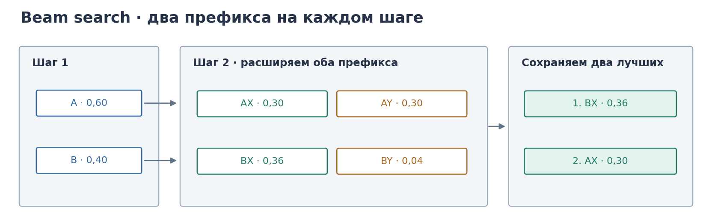
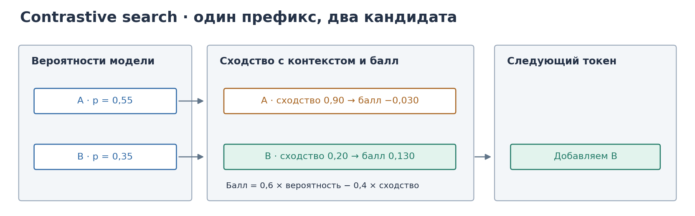
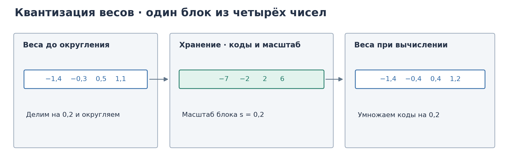
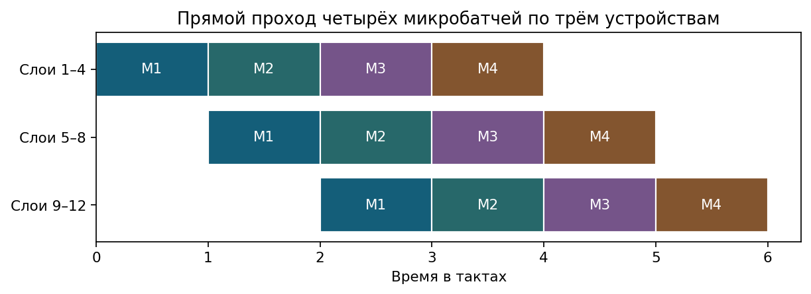

# 6. Инференс, масштаб обучения и выравнивание


Архитектура задаёт вычислительный граф. На сервисе и при дообучении решают другие вопросы: какие фазы генерации ограничены вычислениями, а какие памятью, как хранить KV, как сжимать веса, как резать модель по устройствам и как переводить предпочтения людей в objective.


## Как модель начинает и продолжает ответ


Пусть промпт имеет длину $n_{\mathrm{prompt}}$. Prefill один раз прогоняет все токены промпта через модель. На этом шаге заполняют KV-кэш и получают распределение на первый новый токен. При достаточной длине промпта матричные умножения хорошо утилизируют GPU: фаза compute-bound. Метрика — Time to First Token, время до первого сгенерированного токена.

Decoding генерирует дальше по одному токену. На шаге $t$ вход — один новый вектор, но внимание читает ключи и значения всех уже прошедших позиций, а линейные слои читают почти все веса модели. Число FLOPs на прочитанный байт мало: фаза memory-bound. Метрика — Inter-Token Latency, средняя задержка между соседними токенами.


## Зачем хранить ключи и значения


В каузальном self-attention на шаге $t$ нужны ключи и значения всех позиций $1,\ldots,t$. Без кэша их пришлось бы пересчитывать из эмбеддингов на каждом шаге заново. KV-кэш сохраняет уже посчитанные строки $K$ и $V$ по слоям. Новый токен добавляет одну строку ключа и одну строку значения на слой.

Объём кэша в float16:


```math
\mathrm{Mem}_{\mathrm{KV}}
\approx
2\cdot b\cdot n\cdot L\cdot h_{\mathrm{kv}}\cdot d_k\cdot 2\ \text{байт}.
```


Здесь первый множитель $2$ учитывает ключи и значения, $b$ — размер batch, $n$ — текущая длина последовательности, $L$ — число слоёв, $h_{\mathrm{kv}}$ — число KV-голов, $d_k$ — размерность головы, последний множитель $2$ — число байт на параметр float16.

GQA уменьшает $h_{\mathrm{kv}}$. Квантизация KV уменьшает число байт на элемент. PagedAttention убирает фрагментацию при переменных $n$.

Ускорение matmul и FlashAttention сильнее двигают TTFT. Сжатие весов и KV сильнее двигают межтокенную задержку.


## Как выбирают следующий токен


На шаге модель выдаёт логиты $z\in\mathbb{R}^{|V|}$ по словарю размера $|V|$. Простейшее правило — жадный выбор: берут токен $\arg\max_i z_i$. Чтобы семплировать случайно, логиты переводят в распределение Softmax. Температура $T>0$ масштабирует логиты до Softmax:


```math
p_i=\frac{e^{z_i/T}}{\sum_{j=1}^{|V|}e^{z_j/T}}.
```


При $T\to 0$ масса схлопывается к $\arg\max_i z_i$. При большом $T$ распределение сглаживается и энтропия растёт.

Top-k. Упорядочивают токены по убыванию $p_i$, оставляют первые $k$, остальным ставят массу $0$ и перенормируют оставшиеся вероятности на сумму $1$.

Top-p, nucleus sampling. Снова упорядочивают токены по убыванию $p_i$. Берут наименьшее $m$ такое, что


```math
\sum_{i=1}^{m}p_{(i)}\ge p,
```


где $p_{(i)}$ — вероятности в порядке убывания. Оставляют только этот префикс длины $m$, обнуляют хвост и перенормируют. В пиковом распределении $m$ мало. В плоском — велико. В отличие от top-k размер ядра подстраивается под форму распределения.

### Поиск по нескольким продолжениям

Жадный выбор оставляет один префикс и больше к отброшенным вариантам не возвращается. Beam search хранит до $B$ префиксов, где $B$ — ширина луча. На каждом шаге он продолжает каждый из них возможными токенами, складывает прежний балл с логарифмом условной вероятности нового токена и оставляет $B$ лучших вариантов среди всех продолжений.

```math
S(y_1,\ldots,y_t)=S(y_1,\ldots,y_{t-1})
+\log p(y_t\mid x,y_1,\ldots,y_{t-1}),\qquad S(\varnothing)=0.
```

На схеме баллы показаны как произведения вероятностей, чтобы их можно было проверить в уме. Логарифм сохраняет их порядок.



На первом шаге лидирует A с вероятностью $0{,}60$. На втором продолжение X имеет вероятность $0{,}50$ после A и $0{,}90$ после B. Поэтому BX набирает $0{,}40\cdot0{,}90=0{,}36$ и обгоняет AX с его $0{,}30$. Для AX и AY баллы равны. На рисунке при равенстве выбран AX. Когда появляется токен конца ответа, соответствующий вариант сохраняют как завершённый. При сравнении ответов разной длины иногда используют поправку за длину, поскольку каждое слагаемое $\log p$ неположительно.

### Выбор токена с учётом повторов

Contrastive search продолжает один префикс. Сначала берут $k$ токенов с наибольшей условной вероятностью. Для каждого кандидата $v$ вычисляют скрытое состояние $h_v$ после его добавления. Затем сравнивают его с состояниями $h_j$ уже обработанных позиций $j=1,\ldots,m$. Чем ближе кандидат к хотя бы одной из этих позиций по косинусной близости, тем больше штраф.

```math
s(v)=\max_{1\le j\le m}\cos(h_v,h_j),
\qquad
\mathrm{score}(v)=(1-\alpha)p(v\mid\text{контекст})-\alpha s(v).
```

Коэффициент $\alpha$ задаёт, сколько веса отдать штрафу за сходство. На схеме оба кандидата оцениваются при $\alpha=0{,}4$.



Кандидат A получает $0{,}6\cdot0{,}55-0{,}4\cdot0{,}90=-0{,}030$. У B вероятность ниже, но сходство с контекстом тоже ниже. Его балл равен $0{,}6\cdot0{,}35-0{,}4\cdot0{,}20=0{,}130$. Поэтому в префикс добавляют B. При $\alpha=0$ правило сводится к жадному выбору.


## Как уменьшить память модели с помощью квантизации

### Из вещественных весов в целочисленные коды

В BF16 или FP16 на вес уходит два байта. Для модели на 7 млрд параметров это около 14 ГБ только под веса. Четыре бита на вес дают 3,5 ГБ под сами коды. К ним добавляются масштабы блоков, служебные данные и тензоры, оставленные в более высокой точности. Размер KV-кэша считают отдельно.

Рассмотрим симметричную равномерную сетку из целых кодов от $-7$ до $7$. Пусть $w_i$ — вес в блоке. Если хотя бы один вес ненулевой, возьмём шаг сетки $s=\max_i|w_i|/7$. Тогда крайний по модулю вес попадёт на границу сетки. Делим каждый вес на шаг, округляем, а при восстановлении умножаем код на шаг.

```math
q_i=\mathrm{round}\left(\frac{w_i}{s}\right),
\qquad \widehat w_i=sq_i.
```

Рассмотрим блок из четырёх весов. Самый большой по модулю вес равен $1{,}4$, поэтому шаг сетки $s=1{,}4/7=0{,}2$. На схеме средняя панель показывает то, что хранится в памяти.



На схеме при округлении ровно посередине выбирается чётный код. Например, $-0{,}3/0{,}2=-1{,}5$ округляется до $-2$, а восстанавливается $-0{,}4$. Код заменяет исходный вес. Шаг сетки один на весь блок. Если в блок попадает большой выброс, шаг растёт и мелкие веса округляются грубее. Более мелкие блоки дают отдельные масштабы для разных диапазонов ценой дополнительных данных.

При **квантизации только весов**, например в схеме W4A16, веса хранятся в четырёх битах, а активации поступают в линейный слой в 16-битном формате. Специализированное ядро читает упакованные веса и распаковывает их порциями во время вычисления. Выигрыш по задержке зависит от того, насколько исходный слой был ограничен чтением памяти и есть ли у рантайма подходящее ядро. Активации и KV-кэш можно квантизовать отдельно.

### Как GPTQ и AWQ учитывают данные слоя

Одинаковая ошибка в двух весах может по-разному менять выход слоя. Пусть $W$ — его матрица весов, а столбцы $X$ — входы этого слоя, собранные на небольшой калибровочной выборке текстов. Выход до квантизации равен $WX$, после неё — $\widehat W X$. В GPTQ целью служит квадрат ошибки на этих выходах.

```math
\mathcal E(\widehat W)=\lVert WX-\widehat W X\rVert_F^2.
```

Для одной строки обозначим через $\delta$ разность между её исходными и восстановленными весами. Тогда вклад строки равен $\lVert\delta X\rVert_2^2=\delta XX^\top\delta^\top$. Его матрица вторых производных по весам равна $2XX^\top$. GPTQ использует эту информацию, чтобы после округления одного столбца скорректировать ещё не округлённые веса и частично компенсировать ошибку на выходе.

AWQ использует калибровочные активации, чтобы выбрать масштабы входных каналов. Пусть $D$ — диагональная матрица с положительными масштабами, а $x$ — вход слоя. До округления домножение столбцов $W$ на $D$ можно точно компенсировать обратным масштабированием входа.

```math
Wx=(WD)(D^{-1}x).
```

После округления равенство уже приближённое. AWQ подбирает масштабы так, чтобы уменьшить ошибку выхода после квантизации $WD$. Увеличение масштаба важного канала может уменьшить его эффективную ошибку после обратного масштабирования. При выборе учитывают весь блок, поскольку увеличение отдельных весов может увеличить и общий шаг сетки.

### Что хранят bitsandbytes и GGUF

**LLM.int8()** в bitsandbytes выделяет каналы с крупными выбросами активаций. Вклад обычных каналов вычисляется по низкоточному пути, вклад выбросных — в более высокой точности. Результаты двух путей складываются.

**NF4** хранит четырёхбитный индекс одного из 16 уровней. Уровни расположены неравномерно и рассчитаны на приблизительно нормально распределённые веса после масштабирования блока. При восстановлении индекс заменяют соответствующим уровнем и умножают на масштаб блока. В QLoRA так хранят замороженные веса, а обучаемые адаптеры обновляют отдельно.

**GGUF** — формат файла. Он хранит метаданные и тензоры, в том числе тензоры с разными способами упаковки. При выборе конкретного GGUF-файла точность и размер определяются типами тензоров в нём, а возможность выполнить вычисления — поддержкой этих типов в рантайме, например в llama.cpp.


## Как распределить обучение между GPU


Одна GPU может не вместить модель, градиенты и состояния оптимизатора. Параллелизм обучения распределяет вычисления и память по устройствам.

### Как разделить батч

Data Parallelism копирует модель на каждое устройство и делит батч. Каждое устройство считает градиент по своему куску батча, затем градиенты усредняют коллективной операцией all-reduce. Без дальнейших оптимизаций каждый процесс хранит полную копию модели, градиентов и состояний оптимизатора.

### Как разделить один слой

Tensor Parallelism режет матрицы одного слоя по устройствам. Типичный приём Megatron: одну линейную проекцию режут по столбцам, следующую — по строкам, а внутри блока делают коллективные операции, чтобы собрать нужные части активаций. Коммуникации частые, поэтому TP ставят внутри узла с быстрым межсоединением.

### Как разделить модель по слоям

Pipeline Parallelism ставит группы соседних слоёв на разные устройства. Входной микробатч проходит конвейером: пока устройство $2$ считает слой группы $2$, устройство $1$ уже может брать следующий микробатч. Без аккуратного расписания возникает пузырь простоя, когда часть устройств ждёт активации предыдущей стадии.



За один такт устройство обрабатывает один микробатч. Пока М1 проходит вторую стадию, первая уже принимает М2. Пустые места в начале и конце показывают, когда устройства простаивают при заполнении и опустошении конвейера.


### Как убрать лишние копии состояния

ZeRO убирает избыточность памяти в режиме data parallel: состояние не копируют целиком на каждый процесс, а режут на доли. Шардировать значит хранить на процессе только свою долю тензора и при необходимости собирать нужный кусок перед использованием.

- Stage 1 режет состояния оптимизатора.
- Stage 2 дополнительно режет градиенты.
- Stage 3 режет и параметры, собирая нужный слой перед вычислением.

Выше стадия — меньше память на процесс и больше коммуникаций. На практике комбинируют ZeRO-DP, TP внутри узла и PP между узлами.


## Как дообучать модель с малым числом параметров


При полном дообучении оптимизатор хранит состояние для каждого обучаемого веса. Можно заморозить исходные параметры и добавить небольшой набор обучаемых параметров. Эту группу методов называют PEFT, то есть дообучением с малым числом обучаемых параметров.

### Как LoRA меняет матрицу весов

LoRA замораживает предобученный вес $W\in\mathbb{R}^{d_{\mathrm{out}}\times d_{\mathrm{in}}}$ и учит низкоранговое обновление


```math
W'=W+\frac{\alpha}{r}BA,
```


где $B\in\mathbb{R}^{d_{\mathrm{out}}\times r}$, $A\in\mathbb{R}^{r\times d_{\mathrm{in}}}$, ранг $r\ll\min(d_{\mathrm{in}},d_{\mathrm{out}})$, коэффициент $\alpha$ масштабирует шаг. Обучают только $A$ и $B$. Несколько задач — несколько адаптеров при одной базе.

### Как сократить память под замороженные веса

QLoRA объединяет LoRA с квантизацией основы модели. Замороженный $W$ хранится в NF4. На прямом проходе его восстанавливают для вычисления в более высокой точности, например BF16. Градиент проходит через вычисления слоя к обучаемым $A$ и $B$. Состояния оптимизатора нужны только для этих адаптеров.

### Как отдельно менять длину и направление веса

В DoRA каждый столбец матрицы представляют как длину, умноженную на единичное направление. Для столбца $w_j$ это $w_j=m_j w_j/\lVert w_j\rVert_2$, где исходно $m_j=\lVert w_j\rVert_2$. При обучении направление вычисляют из $w_j+\Delta w_j$, где $\Delta W$ — низкоранговая добавка LoRA. Длины $m_j$ обучаются отдельно.

### Как дообучать модель через вход и внимание

Обычный текстовый промпт превращается в токены словаря. Их эмбеддинги образуют последовательность векторов на входе модели. Если цель — обучить сам промпт градиентным спуском, можно завести несколько дополнительных векторов, которые вообще не привязаны к токенам словаря. Такой непрерывный промпт называют мягким.

В исходном **P-Tuning** эти векторы размещают во входном шаблоне, например вокруг текста задачи. Их строит небольшой обучаемый кодировщик промпта. Параметры непрерывных позиций получают градиент от потери модели.

**Prefix Tuning** даёт каждому слою внимания собственный обучаемый префикс. В реализации через KV это дополнительные строки ключей и значений, которые ставят перед ключами и значениями текста. Если в слое было $n$ позиций текста и добавлено $m$ позиций префикса, запрос текста теперь может читать до $n+m$ позиций с учётом маски. При дообучении исходные веса модели заморожены, а градиент меняет параметры префикса.

## Как обучать модель по предпочтениям людей


Исходная предобученная модель умеет продолжать текст, но ещё не следует инструкциям. Supervised fine-tuning, SFT, дообучает её на парах «промпт → желаемый ответ» обычным правдоподобием следующего токена. Обозначим ответ длины $T$ через $y=(y_1,\ldots,y_T)$. Вероятность всего ответа равна произведению вероятностей каждого токена при заданном промпте $x$ и уже известных токенах ответа. Для $t=1$ контекст состоит только из промпта.


```math
\pi_{\mathrm{SFT}}(y\mid x)
=\prod_{t=1}^{T}p_{\theta}(y_t\mid x,y_1,\ldots,y_{t-1}).
```


Эту модель часто берут и как стартовую политику, и как референс $\pi_{\mathrm{ref}}$.

SFT не знает, какой из двух правдоподобных ответов людям нравится больше. Поэтому собирают предпочтения: для промпта $x$ человек указывает, что ответ $y_w$ лучше ответа $y_l$. По таким тройкам $(x,y_w,y_l)$ учат reward-модель $r_\phi(x,y)$ — скалярную оценку ответа. Обычно её параметризуют той же архитектурой, что и политику, и учат логистической потерей Bradley–Terry, о которой ниже.

Целевой функционал RLHF для политики $\pi$ при фиксированной reward-модели:


```math
\max_{\pi}\ 
\mathbb{E}_{x\sim\mathcal{D},\,y\sim\pi(\cdot\mid x)}\bigl[r_\phi(x,y)\bigr]
-\beta\,
\mathbb{E}_{x\sim\mathcal{D}}
\bigl[
\mathrm{KL}\bigl(\pi(\cdot\mid x)\,\|\,\pi_{\mathrm{ref}}(\cdot\mid x)\bigr)
\bigr].
```


Первый член тянет к высокой награде. Второй — штраф KL к референсу: он не даёт политике уходить в области, где $r_\phi$ ненадёжна, и сохраняет беглость языка.

На практике этот функционал оптимизируют методом ближайшей политики, PPO. Сэмплируют ответы из текущей $\pi_\theta$, оценивают преимущество через value-сеть, делают clipped policy gradient updates. PPO здесь — численный способ приблизить тот же KL-регуляризованный objective, а не отдельная целевая функция.


## Оптимум KL-регуляризованной задачи


Зафиксируем промпт $x$ и опустим его в обозначениях, где это не мешает. Нужно максимизировать по распределениям $\pi$ на ответах


```math
J(\pi)
=\sum_{y}\pi(y)\,r(y)
-\beta\sum_{y}\pi(y)\log\frac{\pi(y)}{\pi_{\mathrm{ref}}(y)},
```


при ограничениях $\pi(y)\ge 0$ и $\sum_y\pi(y)=1$.

Перепишем:


```math
\frac{J(\pi)}{\beta}
=\sum_{y}\pi(y)\log\pi_{\mathrm{ref}}(y)
+\sum_{y}\pi(y)\frac{r(y)}{\beta}
-\sum_{y}\pi(y)\log\pi(y).
```


Введём вспомогательное распределение


```math
\pi^*(y)
=\frac{1}{Z}\pi_{\mathrm{ref}}(y)\exp\Bigl(\frac{r(y)}{\beta}\Bigr),
\qquad
Z=\sum_{y'}\pi_{\mathrm{ref}}(y')\exp\Bigl(\frac{r(y')}{\beta}\Bigr).
```


Тогда


```math
\log\pi^*(y)=\log\pi_{\mathrm{ref}}(y)+\frac{r(y)}{\beta}-\log Z,
```


и


```math
\frac{J(\pi)}{\beta}
=\sum_{y}\pi(y)\log\pi^*(y)
-\sum_{y}\pi(y)\log\pi(y)
+\log Z
=-\mathrm{KL}(\pi\|\pi^*)+\log Z.
```


Слагаемое $\log Z$ не зависит от $\pi$. Максимизация $J(\pi)$ эквивалентна минимизации $\mathrm{KL}(\pi\|\pi^*)$. Минимум KL равен нулю и достигается при $\pi=\pi^*$. Возвращая зависимость от $x$,


```math
\pi^*(y\mid x)
=\frac{1}{Z(x)}
\pi_{\mathrm{ref}}(y\mid x)
\exp\Bigl(\frac{1}{\beta}r(x,y)\Bigr),
```


```math
Z(x)=\sum_{y}\pi_{\mathrm{ref}}(y\mid x)\exp\bigl(r(x,y)/\beta\bigr).
```


Это и есть оптимальная политика KL-регуляризованного RLHF. PPO пытается приблизить её сэмплированием и градиентами. DPO пойдёт другим путём: выразит $r$ через $\pi^*$ и подставит в модель предпочтений.


## От оптимальной политики к формуле для награды


Логарифмируем определение $\pi^*$:


```math
\log\pi^*(y\mid x)
=\log\pi_{\mathrm{ref}}(y\mid x)+\frac{1}{\beta}r(x,y)-\log Z(x).
```


Умножаем на $\beta$ и переносим члены:


```math
r(x,y)
=\beta\log\frac{\pi^*(y\mid x)}{\pi_{\mathrm{ref}}(y\mid x)}
+\beta\log Z(x).
```


Награда равна $\beta$ раз логарифму отношения оптимальной политики к референсу плюс член, зависящий только от $x$. Именно эта формула позволит сократить $Z(x)$ в парных сравнениях.


## Bradley–Terry и вывод потери DPO


Модель предпочтений Bradley–Terry утверждает: вероятность предпочесть $y_w$ ответу $y_l$ при промпте $x$ есть логистическая сигмоида от разности наград:


```math
P(y_w\succ y_l\mid x)
=\sigma\bigl(r(x,y_w)-r(x,y_l)\bigr)
=\frac{1}{1+\exp\bigl(-(r(x,y_w)-r(x,y_l))\bigr)}.
```


Подставляют выражение для $r$:


```math
r(x,y_w)-r(x,y_l)
=\beta\log\frac{\pi^*(y_w\mid x)}{\pi_{\mathrm{ref}}(y_w\mid x)}
-\beta\log\frac{\pi^*(y_l\mid x)}{\pi_{\mathrm{ref}}(y_l\mid x)}.
```


Члены $\beta\log Z(x)$ сократились. Поэтому


```math
P(y_w\succ y_l\mid x)
=\sigma\Bigl(
\beta\log\frac{\pi^*(y_w\mid x)}{\pi_{\mathrm{ref}}(y_w\mid x)}
-\beta\log\frac{\pi^*(y_l\mid x)}{\pi_{\mathrm{ref}}(y_l\mid x)}
\Bigr).
```


Оптимальная $\pi^*$ неизвестна. DPO заменяет её параметризованной политикой $\pi_\theta$ и максимизирует правдоподобие наблюдаемых предпочтений. Для одной тройки вклад в логарифмическое правдоподобие есть


```math
\log\sigma\Bigl(
\beta\log\frac{\pi_\theta(y_w\mid x)}{\pi_{\mathrm{ref}}(y_w\mid x)}
-\beta\log\frac{\pi_\theta(y_l\mid x)}{\pi_{\mathrm{ref}}(y_l\mid x)}
\Bigr).
```


Усреднение с минусом даёт потерю DPO:


```math
\mathcal{L}_{\mathrm{DPO}}
=-\mathbb{E}_{(x,y_w,y_l)}
\log\sigma\Bigl(
\beta\log\frac{\pi_\theta(y_w\mid x)}{\pi_{\mathrm{ref}}(y_w\mid x)}
-\beta\log\frac{\pi_\theta(y_l\mid x)}{\pi_{\mathrm{ref}}(y_l\mid x)}
\Bigr).
```


Явная reward-модель на этапе оптимизации политики не нужна: она исключена сменой переменных. DPO оптимизирует ту же KL-регуляризованную задачу, что стоит за RLHF, но напрямую по $\pi_\theta$ на фиксированном датасете пар. PPO приближает ту же задачу онлайн через сэмплирование и critic. Цена DPO — offline-обучение: при долгом апдейте распределение пар может расходиться с текущей $\pi_\theta$.

KTO работает с полезными и бесполезными примерами без обязательных пар. ORPO совмещает имитацию предпочтённого ответа со штрафом на относительную вероятность отклонённого в одном objective.


## Источники


- Kwon et al. Efficient Memory Management for Large Language Model Serving with PagedAttention. SOSP 2023
- Frantar et al. GPTQ. ICLR 2023
- Lin et al. AWQ. MLSys 2024
- Rajbhandari et al. ZeRO. SC 2020
- Shoeybi et al. Megatron-LM
- Hu et al. LoRA. ICLR 2022
- Dettmers et al. QLoRA. NeurIPS 2023
- Ouyang et al. Training language models to follow instructions with human feedback. NeurIPS 2022
- Rafailov et al. Direct Preference Optimization. NeurIPS 2023
