# 8. Бандиты — как выбирать действия и учиться на откликах

Сервис может выбрать одно из нескольких предложений для клиента. После выбора он узнаёт, воспользовался ли клиент предложением и сколько денег оно принесло. Для того же клиента в тот же момент отклики на остальные предложения остаются неизвестными.

Если всё время отправлять вариант с лучшей исторической конверсией, можно пропустить более выгодный вариант, который раньше почти не показывали. Если распределять все предложения поровну, накопится информация, но значительная часть клиентов будет получать уже известные слабые варианты. Алгоритмы бандитов управляют этим компромиссом. Они выбирают действие, получают частичную обратную связь и используют её при следующих решениях.

Чтобы понять эту постановку, начнём с обучения с подкреплением. Дальше будем постепенно упрощать задачу, пока не получим бандита, а затем добавим признаки клиента, ограничения на действия и оценку по историческим данным.


## Как устроено обучение с подкреплением

### Состояние, действие и награда

В обучении с подкреплением, reinforcement learning или RL, алгоритм взаимодействует со средой. Алгоритм, принимающий решения, называют **агентом**. **Среда** — всё, откуда агент получает наблюдения и последствия своих действий.

В момент $t$ агент получает состояние $S_t$, выбирает действие $A_t$, после чего среда выдаёт награду $R_t$ и переходит в состояние $S_{t+1}$. Заглавные буквы обозначают случайные величины. Их конкретные значения будем писать строчными буквами.

Состояние описывает информацию, достаточную для принятия решения и предсказания следующего шага. Например, оно может включать текущие продукты клиента, историю контактов и оставшийся бюджет. Если вероятность следующего состояния и награды зависит от прошлого только через текущее состояние и выбранное действие, выполняется **марковское свойство**.

```math
p(S_{t+1},R_t\mid S_1,A_1,\ldots,S_t,A_t)
=p(S_{t+1},R_t\mid S_t,A_t).
```

Такую задачу описывает **марковский процесс принятия решений**, MDP. В его описание входят возможные состояния, действия, вероятности переходов и распределения наград. Переходом называют изменение состояния после действия.

**Политика** задаёт правило выбора действия. Стохастическая политика $\pi(a\mid s)$ возвращает вероятность выбрать действие $a$ в состоянии $s$. Вероятности всех допустимых действий суммируются в единицу. У детерминированной политики одно из них получает вероятность $1$.

### Почему награда одного шага может быть недостаточна

Если сегодня выдать скидку, клиент может купить продукт сразу, а в дальнейшем ждать скидок на каждую покупку. Для оценки такого действия приходится учитывать несколько будущих наград. Пусть $T$ — последний шаг взаимодействия, а $0\le\gamma\le1$ — коэффициент дисконтирования. Возвратом, или return, называют взвешенную сумму будущих наград.

```math
G_t=R_t+\gamma R_{t+1}+\gamma^2R_{t+2}+\cdots
=\sum_{k=0}^{T-t}\gamma^kR_{t+k}.
```

При $\gamma\lt 1$ отдалённые награды имеют меньший вес. Для конечного горизонта допустимо $\gamma=1$. Ожидание возврата зависит от политики, потому что она определяет будущие действия.

**Ценность действия** $Q^\pi(s,a)$ — ожидаемый возврат, если начать в состоянии $s$, выбрать $a$, а дальше следовать политике $\pi$. Усреднение идёт по случайным наградам, переходам среды и последующим действиям политики.

```math
Q^\pi(s,a)=\mathbb E_\pi[G_t\mid S_t=s,A_t=a].
```

Из определения возврата следует $G_t=R_t+\gamma G_{t+1}$. Подставим это равенство в определение $Q^\pi$ и условимся по следующему состоянию. Обозначим $r(s,a)=\mathbb E[R_t\mid S_t=s,A_t=a]$, а через $P(s'\mid s,a)$ — вероятность перехода в $s'$.

```math
Q^\pi(s,a)=r(s,a)
+\gamma\sum_{s'}P(s'\mid s,a)\sum_{a'}\pi(a'\mid s')Q^\pi(s',a').
```

Это **уравнение Беллмана** для ценности действия. Первая часть — награда текущего шага. Вторая — ожидаемая ценность продолжения. Здесь для определённости состояния и действия дискретны.

Если $Q^\pi$ неизвестна, её можно приближать по наблюдаемым переходам. В табличном Q-learning хранят число для каждой пары состояния и действия. Цель — оценить наилучшую достижимую ценность $Q^*$. После одного перехода строят цель $R_t+\gamma\max_{a'}Q_t(S_{t+1},a')$ и двигают текущую оценку к ней с шагом $\eta_t$.

```math
Q_{t+1}(S_t,A_t)
=Q_t(S_t,A_t)+\eta_t
\left[R_t+\gamma\max_{a'}Q_t(S_{t+1},a')-Q_t(S_t,A_t)\right].
```

Один переход используется для обновления оценки, а все остальные записи таблицы остаются прежними. В больших пространствах вместо таблицы обучают модель. Для дальнейшей главы важно понять, откуда возникает слагаемое о будущих состояниях.


На готовой схеме agent — агент, environment — среда, action — действие, state — состояние, reward — награда. Проследите замкнутый путь от действия к новому состоянию. Именно этот путь делает последствия решения многошаговыми.

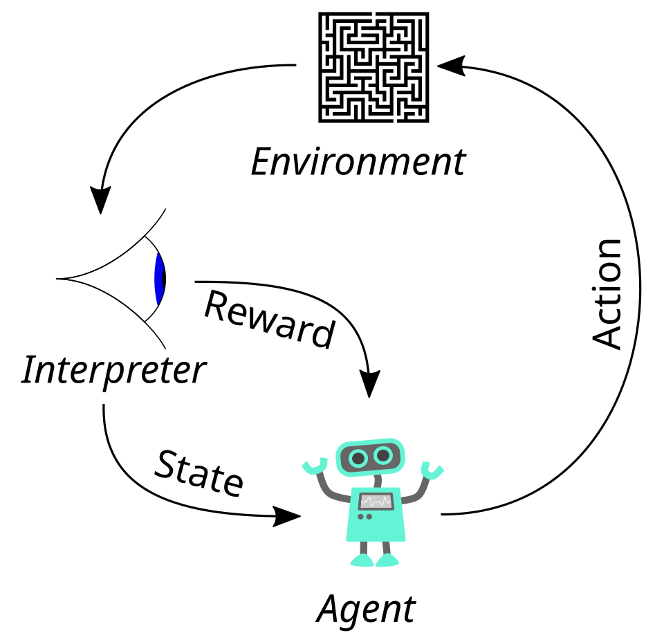

Megajuice, CC0. [Источник](https://commons.wikimedia.org/wiki/File:Reinforcement_learning_diagram.svg)


## Как из RL получается задача бандита

Представим, что каждое решение заканчивается одной измеренной наградой. Следующий клиент приходит независимо от выбранного для предыдущего клиента предложения. Тогда продолжение не зависит от текущего действия, и для выбора достаточно сравнивать ожидаемые награды текущего решения. В эпизоде длины один возврат просто равен $R_t$.

Получаем **многорукого бандита**, multi-armed bandit. Вариант действия традиционно называют **рукой**, arm. Название пришло от игровых автоматов с рычагом. В прикладной задаче руками могут быть предложения, каналы связи, тексты уведомлений или разные рекомендательные алгоритмы.

В базовой постановке есть $K$ рук с номерами $a=1,\ldots,K$. У каждой своё неизвестное распределение награды. На шаге $t$ мы выбираем $A_t$, видим награду только этой руки и обновляем знания. Уже выполненные действия и полученные награды составляют историю

```math
H_{t-1}=(A_1,R_1,\ldots,A_{t-1},R_{t-1}).
```

Политика теперь может зависеть от этой истории. Она учится вместе с накоплением данных.

В **стационарном стохастическом бандите** распределение награды каждой руки постоянно во времени, а новые награды этой руки независимы от предыдущих. Среднюю награду руки обозначим через $\mu_a$. Для бинарного отклика $R_t\in\{0,1\}$ это вероятность успеха.

```math
\mu_a=\mathbb E[R_t\mid A_t=a].
```

Пусть у предложений A и B истинные вероятности покупки равны $0.08$ и $0.12$. Они неизвестны алгоритму. Из десяти первых показов A может получить две покупки, а B — ни одной. Это возможный результат случайности. Жадный алгоритм выберет A и может долго не получать новых данных о B.

Выбор уже хорошо зарекомендовавшей себя руки называют **использованием знаний**, exploitation. Выбор ради уменьшения неопределённости называют **исследованием**, exploration. Одна и та же отправка приносит и награду, и информацию.

В коммуникациях один клиент часто встречается повторно. Если контакт меняет его будущую восприимчивость, а сегодняшнее решение определяет будущие возможности, полноценная постановка снова становится последовательной. Контекстный бандит остаётся приближением, качество которого зависит от выбранного горизонта награды и силы этих последствий.


У каждой руки своё распределение награды. Ширина фигуры на определённой высоте показывает, насколько часто встречаются такие значения. Даже рука с большим средним иногда даёт награду хуже слабой руки. Здесь показаны вещественные награды, поэтому возможны и отрицательные значения.

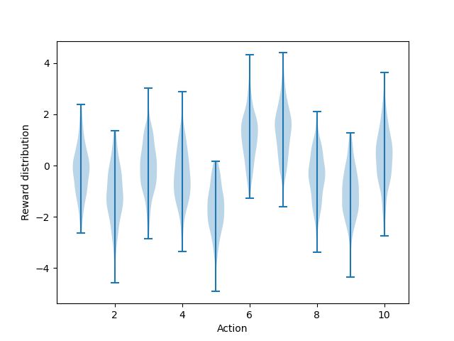

Shangtong Zhang, MIT. [Пример 2.1](https://github.com/ShangtongZhang/reinforcement-learning-an-introduction/blob/master/images/figure_2_1.png)


## Что именно оптимизирует бандит

### Сумма наград и сожаление

За $T$ решений политика получает суммарную награду $\sum_{t=1}^TR_t$. В базовой стационарной задаче эталон — всегда выбирать руку с максимальным средним $\mu_*=\max_a\mu_a$.

**Ожидаемое псевдосожаление**, expected pseudo-regret, измеряет потери от выбора рук с худшим средним. Ожидание берётся по случайности алгоритма и истории наблюдений.

```math
\mathcal R_T
=T\mu_*-\mathbb E\left[\sum_{t=1}^{T}\mu_{A_t}\right]
=\mathbb E\left[\sum_{t=1}^{T}(\mu_*-\mu_{A_t})\right].
```

В стохастической постановке ожидаемая сумма фактических наград равна ожидаемой сумме средних выбранных рук. Обозначим через $\Delta_a=\mu_*-\mu_a$ отставание руки, а через $N_T(a)$ — число её выборов за $T$ решений. Сгруппировав слагаемые по рукам, получаем

```math
\mathcal R_T=\sum_{a=1}^{K}\Delta_a\,\mathbb E[N_T(a)].
```

Если рука с конверсией $0.08$ выбрана 200 раз вместо руки с конверсией $0.12$, её вклад в псевдосожаление равен $200(0.12-0.08)=8$ ожидаемых покупок. Фактическая разность покупок на конкретном запуске будет случайной.

**Сублинейное сожаление** означает $\mathcal R_T/T\to0$. Средняя потеря на решение тогда убывает. В рабочей системе истинные $\mu_a$ неизвестны, поэтому сожаление напрямую измеряют прежде всего в симуляциях с известными распределениями.

### Когда нужно найти одну лучшую руку

В задаче **идентификации лучшей руки** после исследования нужно выбрать единственный вариант для дальнейшего использования. Здесь часто фиксируют бюджет эксперимента или допустимую вероятность ошибочного выбора.

При фиксированном бюджете $B$ алгоритм распределяет $B$ наблюдений и возвращает руку $\widehat a$. Одна из мер качества — ожидаемое простое сожаление $\mathbb E[\mu_*-\mu_{\widehat a}]$. Важен итоговый выбор после эксперимента. В задаче максимизации суммарной награды важна также цена каждого исследовательского шага. Из-за этого распределение наблюдений может различаться.

Если нужно выбрать один текст рассылки для последующего массового запуска, подходит постановка идентификации. Если поток решений идёт постоянно и доход нужно получать уже во время обучения, естественна максимизация суммарной награды.

Один из способов искать лучшую руку — **последовательное исключение**. Для каждой активной руки строят нижнюю и верхнюю границы среднего. Если верхняя граница одной руки уже ниже нижней границы другой, первую исключают из дальнейшего исследования. Оставшимся продолжают выдавать наблюдения, пока не останется одна рука или не закончится бюджет. Для гарантии вероятности ошибки границы калибруют с учётом многократных сравнений и просмотров во времени.


## Как оценивать награды по мере поступления

Пусть до текущего шага рука $a$ была выбрана $n$ раз, а сумма её наград равна $S$. Её выборочное среднее равно $\widehat\mu=S/n$. После новой награды $r$ получаем $(S+r)/(n+1)$. Заменив $S$ на $n\widehat\mu$, выведем обновление без хранения всей истории.

```math
\widehat\mu_{\mathrm{new}}
=\frac{n\widehat\mu+r}{n+1}
=\widehat\mu+\frac{r-\widehat\mu}{n+1}.
```

Например, после 20 отправок и двух покупок оценка равна $0.10$. При следующей покупке новое среднее составит $3/21\approx0.143$. При отсутствии покупки получится $2/21\approx0.095$.

У разных рук обновляются разные счётчики. Отсутствие покупки после показа A обновляет A. Награда B в этом решении остаётся неизвестной.

Для ещё не выбранной руки среднее не определено. Стартовые наблюдения можно собрать отдельным случайным распределением трафика или задать начальное вероятностное представление о награде. Далее увидим оба способа.


## Как исследовать случайно

### Равномерный выбор и отдельный этап исследования

При равномерной политике каждая из $K$ рук получает вероятность $1/K$. Она даёт данные обо всех вариантах и служит понятным начальным ориентиром.

В методе **explore-then-commit** сначала каждую руку выбирают $m$ раз, затем до конца горизонта используют руку с лучшим средним. Исследовательская часть требует $Km$ решений. Малое $m$ увеличивает риск ошибиться, большое $m$ тратит больше награды на слабые руки. После фиксации выбора метод перестаёт пересматривать решение.

### Эпсилон-жадная политика

В **ε-greedy** на каждом шаге с вероятностью $1-\varepsilon$ выбирают текущую лучшую руку, а с вероятностью $\varepsilon$ исследуют. В исследовательской части выберем равномерно из всех $K$ рук, включая лучшую.

В этом правиле две ветви выбора — использование лучшей оценки и случайное исследование. Число доступных действий $K$ задаётся отдельно. В формуле ниже две строки описывают лучшую руку и каждую из остальных рук.

Пусть $\widehat a$ — одна лучшая рука после разрешения возможных равенств оценок. Её можно получить и в основной, и в случайной ветви. Вероятность выбора в основной ветви равна $1-\varepsilon$, а в исследовательской — $\varepsilon/K$. Эти события складываются, поэтому итоговая вероятность лучшей руки равна $1-\varepsilon+\varepsilon/K$. Каждая другая рука выбирается только в исследовательской ветви.

```math
\pi(a\mid H_{t-1})=
\begin{cases}
1-\varepsilon+\dfrac{\varepsilon}{K}, & a=\widehat a,\\
\dfrac{\varepsilon}{K}, & a\ne\widehat a.
\end{cases}
```

У лучшей руки одна вероятность, а у каждой из остальных $K-1$ рук — по $\varepsilon/K$. Складываем вероятности всех рук.

```math
\underbrace{\left(1-\varepsilon+\frac{\varepsilon}{K}\right)}_{\text{лучшая рука}}
+
\underbrace{(K-1)\frac{\varepsilon}{K}}_{\text{все остальные руки}}
=1-\varepsilon+\frac{K\varepsilon}{K}=1.
```

Постоянное $\varepsilon$ оставляет ненулевую долю исследований даже после уверенного обнаружения лучшей руки. Если есть руки с положительным отставанием, ожидаемые потери только от равномерной части составляют

```math
\frac{T\varepsilon}{K}\sum_{a=1}^{K}\Delta_a.
```

Для стационарной задачи используют также убывающее $\varepsilon_t$, сохраняя достаточно исследований. В изменяющейся среде исследовательский трафик нужен и после начального обучения.

Результаты случайного исследования зависят от того, какие руки в него допустили. Отправка запрещённого предложения с малой вероятностью всё равно нарушает ограничение. Фильтрация допустимых действий происходит до случайного выбора.

На левом графике показана средняя награда на очередном шаге, на правом — доля выбора оптимальной руки. Это усреднение по повторениям учебного эксперимента с десятью руками. Жадная политика с ε = 0 рано перестаёт улучшаться. Исследование с ε = 0.10 на показанном горизонте чаще находит хорошую руку.

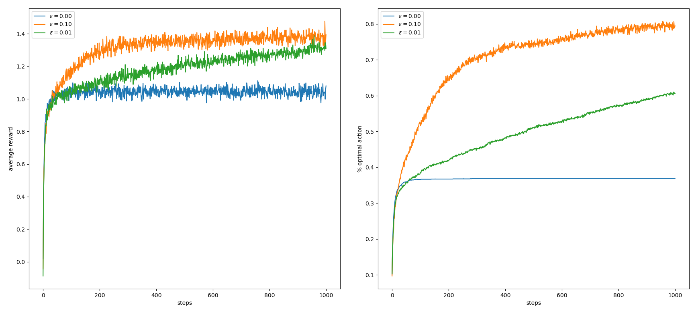

Shangtong Zhang, MIT. Два графика исходного изображения размещены рядом. [Пример 2.2](https://github.com/ShangtongZhang/reinforcement-learning-an-introduction/blob/master/images/figure_2_2.png)


### Как распределять исследования по оценкам

В **Boltzmann exploration**, или softmax-исследовании, каждой руке дают вероятность, растущую с оценкой её награды. Параметр температуры $\tau>0$ регулирует, насколько сильно вероятности различаются.

```math
\pi(a)=\frac{e^{\widehat\mu_a/\tau}}{\sum_b e^{\widehat\mu_b/\tau}}.
```

При большой температуре распределение приближается к равномерному, при малой концентрируется около максимума. Однако две одинаковые оценки получают одинаковую вероятность, даже если одна основана на одном наблюдении, а другая — на тысяче. Чтобы учитывать надёжность оценок, перейдём к доверительным границам.


## Как исследовать через доверительную границу

### Откуда появляется бонус неопределённости

Средние награды двух рук могут совпадать, хотя одна показана 20 раз, а другая — 20 тысяч. Во втором случае оценка обычно точнее. **Upper Confidence Bound**, UCB, прибавляет к оценке бонус, который уменьшается с числом наблюдений.

Пусть награды независимы и лежат в $[0,1]$. Для среднего по фиксированным $n$ наблюдениям неравенство Хёффдинга ограничивает вероятность недооценить истинное среднее более чем на $b$.

```math
\Pr(\mu_a>\widehat\mu_a+b)\le e^{-2nb^2}.
```

Зададим малую вероятность $\delta$ и решим уравнение $e^{-2nb^2}=\delta$ относительно $b$. После логарифмирования $-2nb^2=\log\delta$, откуда

```math
b=\sqrt{\frac{\log(1/\delta)}{2n}}.
```

Если на шаге $t$ положить $\delta=1/t^4$, получим $b=\sqrt{2\log t/n}$. Это мотивирует индекс UCB1. Здесь $N_{t-1}(a)$ — число выборов руки до текущего решения.

```math
U_t(a)=\widehat\mu_{t-1}(a)+
\sqrt{\frac{2\log t}{N_{t-1}(a)}},
\qquad A_t=\arg\max_a U_t(a).
```

Сначала каждую руку выбирают хотя бы один раз. При повторном использовании случайного счётчика наблюдений доказательство границы сожаления требует учёта всех возможных значений счётчика и шагов. Приведённая выкладка объясняет форму бонуса.

### Как читать индекс UCB

Пусть $t=1000$. У A среднее $0.10$ по 900 наблюдениям, у B — $0.08$ по 100. Для A бонус равен примерно $0.124$, для B — $0.372$. Индексы получаются $0.224$ и $0.452$. Алгоритм выбирает B ради уменьшения неопределённости.

Эти границы могут быть очень широкими для редких событий. Число $0.452$ — оптимистический индекс, его смысл определяется суммой оценки и бонуса. Для бернуллиевских наград существуют более подходящие к форме распределения границы, например KL-UCB. В них расстояние между вероятностями измеряют дивергенцией Бернулли.

Для стационарных ограниченных наград и фиксированных положительных разрывов оценка ожидаемого сожаления UCB1 имеет порядок

```math
\mathcal R_T=O\left(\sum_{a:\Delta_a>0}\frac{\log T}{\Delta_a}\right).
```

Когда руки очень близки по качеству, надёжно отличить их трудно, но цена неправильного выбора тоже мала.

UCB направляет исследования в руки с конкурентоспособной верхней границей. Сильно отстающая рука со множеством наблюдений постепенно перестаёт конкурировать. ε-greedy в случайной ветви продолжает выдавать ей долю трафика. При этом у ε-greedy итоговую вероятность выбора можно сразу записать в лог, а базовый UCB при фиксированной истории и правиле разрешения равенств детерминирован.


Сравним средние награды на очередном шаге, усреднённые по повторным экспериментам. В этой реализации UCB используется следующий бонус. Здесь $N$ — число наблюдений выбранной руки, а на графике $c=2$.

```math
c\sqrt{\frac{\log t}{N}}.
```

На данном наборе UCB обгоняет ε-greedy после начального исследования.

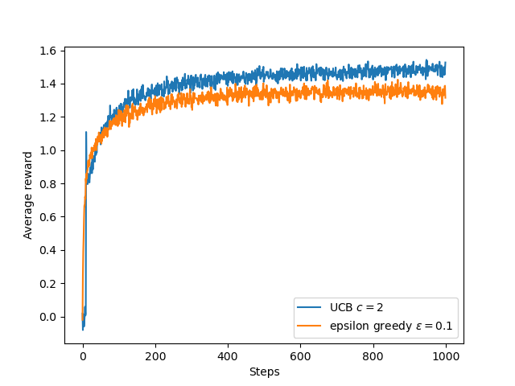

Shangtong Zhang, MIT. [Пример 2.4](https://github.com/ShangtongZhang/reinforcement-learning-an-introduction/blob/master/images/figure_2_4.png)


## Как выбирать по вероятностной модели награды

### Распределение на неизвестной конверсии

Теперь рассмотрим бинарную награду. Зафиксируем одну руку и обозначим её неизвестную вероятность успеха через $\theta$. При данном $\theta$ один отклик $r$ равен $1$ с вероятностью $\theta$ и $0$ с вероятностью $1-\theta$. Эти два случая можно объединить одной записью.

```math
p(r\mid\theta)=\theta^r(1-\theta)^{1-r},
\qquad r\in\{0,1\}.
```

Обозначим полученную последовательность откликов через $D=(r_1,\ldots,r_n)$. При заданном $\theta$ считаем их независимыми. Поэтому вероятность всей последовательности равна произведению вероятностей отдельных откликов. Пусть $S=\sum_i r_i$ — число успехов, а $F=n-S$ — число неудач.

```math
p(D\mid\theta)
=\prod_{i=1}^{n}\theta^{r_i}(1-\theta)^{1-r_i}
=\theta^S(1-\theta)^F.
```

Когда данные $D$ уже известны, рассматриваем это выражение как функцию неизвестного параметра $\theta$. Такую функцию называют **правдоподобием** и обозначают $L(\theta)=p(D\mid\theta)$. Она показывает, насколько полученные данные согласуются с каждым предполагаемым значением конверсии.

Теперь опишем неопределённость о $\theta$ до наблюдения данных. В байесовском подходе для этого задают **априорную плотность** $p(\theta)$. Для вероятности из интервала $(0,1)$ удобно бета-распределение с параметрами $\alpha>0$ и $\beta>0$. Его плотность имеет следующую форму.

```math
p(\theta)\propto\theta^{\alpha-1}(1-\theta)^{\beta-1}.
```

Знак $\propto$ означает равенство с точностью до постоянного множителя. Этот множитель обеспечивает единичный интеграл плотности. При $\alpha=\beta=1$ плотность равномерна. Другие параметры меняют относительный вес возможных конверсий.

После наблюдения $D$ нужна **апостериорная плотность** $p(\theta\mid D)$. Её можно получить по формуле Байеса:

```math
p(\theta\mid D)=\frac{p(D\mid\theta)\,p(\theta)}{p(D)},
\qquad
p(D)=\int_0^1p(D\mid u)\,p(u)\,du.
```

В интеграле $u$ — переменная, перебирающая возможные значения конверсии. Знаменатель усредняет вероятность данных по априорному распределению и нормирует результат. Для всех сравниваемых $\theta$ это одно и то же число. Поэтому форму апостериорной плотности определяет произведение правдоподобия и априорной плотности.

```math
p(\theta\mid D)\propto L(\theta)\,p(\theta).
```

Это и объясняет умножение. Каждое значение $\theta$ получает свой прежний вес, умноженный на вероятность получить полученные данные при этом значении. Подставим обе полученные выше функции и сложим показатели одинаковых оснований.

```math
p(\theta\mid D)
\propto
\theta^S(1-\theta)^F
\theta^{\alpha-1}(1-\theta)^{\beta-1}
=
\theta^{\alpha+S-1}(1-\theta)^{\beta+F-1}.
```

Получили бета-распределение с параметрами $\alpha+S$ и $\beta+F$. Такое совпадение семейства до и после обновления называют **сопряжённостью**. Например, из равномерного априорного распределения $\mathrm{Beta}(1,1)$ после двух успехов и одной неудачи получается $\mathrm{Beta}(3,2)$. Теперь это распределение можно использовать для выбора следующего действия.

### Thompson Sampling

**Thompson Sampling**, или выборка Томпсона, на каждом шаге случайно выбирает возможное значение конверсии из апостериорного распределения каждой руки. Затем действует так, будто эти значения и есть истинные конверсии.

```math
\widetilde\theta_a\sim
\mathrm{Beta}(\alpha_a+S_a,\beta_a+F_a),
\qquad
A_t=\arg\max_a\widetilde\theta_a.
```

После отклика изменяют счётчики только выбранной руки. При успехе увеличивают $S_a$, при неудаче — $F_a$. Случайность находится в выборке параметров. При точной байесовской модели вероятность выбрать руку совпадает с апостериорной вероятностью того, что она лучшая, с учётом правила разрешения равенств.

Для $\mathrm{Beta}(\alpha,\beta)$ среднее равно $\alpha/(\alpha+\beta)$. Пусть у A после априорного $\mathrm{Beta}(1,1)$ накопилось 8 покупок и 92 отказа. Её распределение стало $\mathrm{Beta}(9,93)$, среднее — $9/102\approx0.088$. У B после одной покупки и девяти отказов получаем $\mathrm{Beta}(2,10)$ со средним $2/12\approx0.167$.

Среднее B выше, но и неопределённость больше. В конкретном решении могут выпасть $\widetilde\theta_A=0.10$ и $\widetilde\theta_B=0.07$, тогда выбирают A. В следующем решении выбор может измениться. На рисунке площади под каждой кривой равны единице, а ширина показывает неопределённость о конверсии.

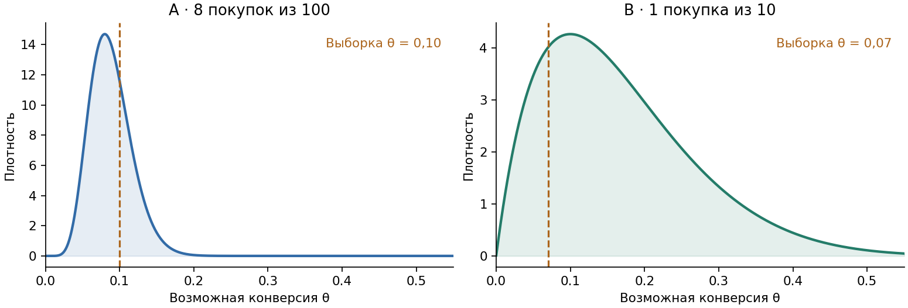

Нельзя восстановить вероятность выбора руки только по выпавшему значению $\widetilde\theta_a$. Для сложного Thompson Sampling вероятность события «рука победила все остальные» вычисляется отдельно, например дополнительными выборками. Для оценки по логам точность этой вероятности существенна.

### Что меняется для денежной награды

Beta–Bernoulli применима к бинарному успеху. Если награда равна прибыли в рублях, подстановка этого числа в счётчики успехов и неудач теряет вероятностный смысл. Можно отдельно моделировать вероятность покупки и доход при покупке либо выбрать модель распределения денежной награды.

Например, предложение A покупают с вероятностью $0.20$ и получают 30 рублей маржи, B покупают с вероятностью $0.10$ и получают 100 рублей. До учёта контакта ожидаемая маржа равна 6 и 10 рублям. Оптимизация покупок выберет A, оптимизация маржи — B.


## Как учитывать признаки клиента и предложения

### Контекстный бандит

До отправки известны признаки клиента, предложения и момента контакта. Эту доступную до решения информацию называют **контекстом** $X_t$. Политика получает контекст, выбирает действие, наблюдает его награду и учится на ней. Получается **контекстный бандит**, contextual bandit.

Среднюю награду теперь обозначим через $\mu(x,a)$. Одна рука может быть лучшей для одного клиента и слабой для другого. Ценность политики $V(\pi)$ — средняя награда при её использовании. Здесь усредняем сначала по действию политики, затем по распределению контекстов.

```math
\mu(x,a)=\mathbb E[R_t(a)\mid X_t=x],
\qquad
V(\pi)=\mathbb E_X\left[\sum_a\pi(a\mid X)\mu(X,a)\right].
```

Обозначение $R_t(a)$ означает награду, которую получили бы при действии $a$ на шаге $t$. Из всех таких потенциальных наград наблюдается только $R_t(A_t)$.

Контекст может включать давность последней покупки, используемые услуги, предыдущие контакты, канал и признаки самого предложения. Значение признака должно существовать до выбора действия. Открытие письма после отправки уже является частью последствий и не подходит как вход для решения, отправлять ли письмо.

Пусть есть две одинаково частые группы. В первой у A и B конверсии $0.20$ и $0.05$, во второй — $0.02$ и $0.15$. Средняя конверсия A равна $0.11$, B — $0.10$. Обычный бандит в пределе предпочтёт A для всех. Политика, которая выбирает A в первой группе и B во второй, получает $(0.20+0.15)/2=0.175$.

### Модель награды и правило выбора

Можно обучить модель $\widehat\mu(x,a)$ на парах «контекст, выбранное действие» и полученных наградах. Для бинарного отклика подойдут логистическая регрессия или бустинг с LogLoss. Однако модель и политика решают разные части задачи. Модель оценивает ожидаемый отклик, политика выбирает действие и организует исследования.

Один рабочий вариант — ε-greedy поверх модели. Для клиента рассчитывают $\widehat\mu(x,a)$ для всех допустимых предложений, выбирают лучшее в основной ветви и случайное в исследовательской. При каждом обновлении обучающей выборки добавляют строку только фактически выбранного действия.

Раздельная модель для каждой руки проще изолирует её поведение, но новая рука начинает почти без данных. Общая модель с признаками действия переносит часть знаний между предложениями. При этом нужно заложить взаимодействия клиента и действия. Если модель имеет вид $f(x)+g(a)$, порядок действий одинаков при любом $x$. Персонализация порядка требует, например, произведений клиентских и продуктовых признаков либо модели, которая сама учит такие взаимодействия.

Недостаток наблюдений для нового клиента или предложения называют **холодным стартом**. Для нового предложения помогают его признаки и ограниченный исследовательский трафик. Если единственный признак действия — ранее не встречавшийся идентификатор, модель почти не получает информации для переноса. Для нового клиента используют доступные общие признаки и начальное безопасное правило, пока не накоплена личная история.

Дисперсия бернуллиевского отклика равна $p(1-p)$. Она описывает случайность покупки. Для исследования нужна ещё неопределённость оценки самого $p$, зависящая от количества и покрытия данных. Предсказание $p=0.5$ само по себе не означает, что модель мало знает об этом клиенте.


В симуляции Vowpal Wabbit две группы пользователей предпочитают разные темы в разное время дня. CTR — число кликов, делённое на число всех показов с начала симуляции. Модель с взаимодействиями признаков клиента и действия обучается учитывать эти различия.

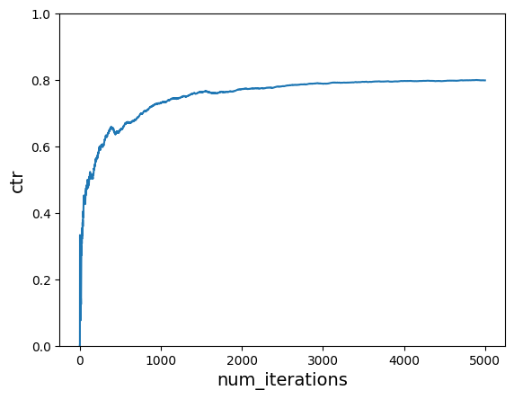

Vowpal Wabbit, BSD-3-Clause. [Условия симуляции](https://vowpalwabbit.org/docs/vowpal_wabbit/python/latest/tutorials/python_Simulating_a_news_personalization_scenario_using_Contextual_Bandits.html)


В том же эксперименте можно отключить взаимодействия и оставить только общие признаки пользователей и действий. Ниже показан результат на той же шкале CTR.

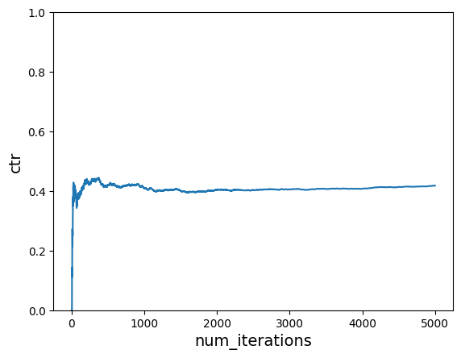

В этом эксперименте модель без взаимодействий выходит примерно на 0.4, а модель с ними — примерно на 0.8. Источник — Vowpal Wabbit, BSD-3-Clause. [Пример с отключёнными взаимодействиями](https://vowpalwabbit.org/docs/vowpal_wabbit/python/latest/tutorials/python_Simulating_a_news_personalization_scenario_using_Contextual_Bandits.html)


## Как LinUCB добавляет неопределённость к линейной модели

### Вывод оценки коэффициентов

Для каждой пары контекста и действия построим вектор $\phi(x,a)\in\mathbb R^d$. В нём собраны признаки и выбранные взаимодействия. Пусть средняя награда приближённо линейна

```math
\mu(x,a)=\phi(x,a)^\top\theta_*.
```

Здесь $\theta_*$ — неизвестный вектор коэффициентов. Для ранее собранных пар запишем $\phi_s=\phi(x_s,a_s)$. По истории до шага $t$ оценим коэффициенты гребневой регрессией с $\lambda>0$.

```math
L(\theta)=\sum_{s=1}^{t-1}(r_s-\phi_s^\top\theta)^2+\lambda\lVert\theta\rVert_2^2.
```

Дифференцируем квадраты по $\theta$ и приравниваем сумму производных к нулю.

```math
\nabla L(\theta)
=-2\sum_{s=1}^{t-1}\phi_s r_s
+2\left(\sum_{s=1}^{t-1}\phi_s\phi_s^\top+\lambda I\right)\theta=0.
```

Введём обозначения:

```math
A_t=\lambda I+\sum_{s=1}^{t-1}\phi_s\phi_s^\top,
\qquad b_t=\sum_{s=1}^{t-1}\phi_s r_s,
\qquad \widehat\theta_t=A_t^{-1}b_t.
```

При новой паре «признаки, награда» достаточно прибавить $\phi_t\phi_t^\top$ к $A_t$ и $\phi_t r_t$ к $b_t$. На практике линейные системы решают устойчивыми численными методами, учитывая стоимость обновления матрицы.

### Вывод бонуса

Оценка коэффициентов зависит от случайных наград. Для вывода бонуса используем доверительную область вокруг $\widehat\theta_t$. Её размер задаёт $c_t$, а форму — матрица $A_t$. С высокой вероятностью истинные коэффициенты удовлетворяют условию

```math
(\widehat\theta_t-\theta_*)^\top
A_t(\widehat\theta_t-\theta_*)\le c_t^2.
```

Возьмём $\delta=\widehat\theta_t-\theta_*$. Ошибка предсказания равна $\phi^\top\delta$. Вставим $A_t^{-1/2}A_t^{1/2}=I$ и применим неравенство Коши — Буняковского.

```math
|\phi^\top\delta|
=|(A_t^{-1/2}\phi)^\top(A_t^{1/2}\delta)|
\le
\sqrt{\phi^\top A_t^{-1}\phi}\,
\sqrt{\delta^\top A_t\delta}
\le c_t\sqrt{\phi^\top A_t^{-1}\phi}.
```

Так получаем индекс LinUCB. Для каждого допустимого действия считаем прогноз и бонус, после чего выбираем максимум.

```math
U_t(x,a)=
\phi(x,a)^\top\widehat\theta_t
+c_t\sqrt{\phi(x,a)^\top A_t^{-1}\phi(x,a)}.
```

Если два действия имеют прогнозы $0.10$ и $0.09$, а соответствующие величины под корнем равны $0.0004$ и $0.01$, при $c_t=0.5$ индексы составят $0.11$ и $0.14$. Победит второе действие с большей неопределённостью.

Здесь дана общая модель с признаками действия. В раздельном варианте LinUCB у каждой руки своя матрица $A_a$, вектор $b_a$ и набор коэффициентов. При выборе оценивают каждую руку, а обновляют только выбранную.


## Как устроить Thompson Sampling с контекстом

В линейной модели можно хранить вероятностное представление о коэффициентах. Пусть $r_s=\phi_s^\top\theta+\epsilon_s$, где шумы $\epsilon_s$ независимы и имеют распределение $\mathcal N(0,\sigma^2)$ с известной дисперсией. Зададим априорное распределение $\theta\sim\mathcal N(0,\sigma^2\lambda^{-1}I)$. Сначала отдельно запишем сумму квадратов ошибок и штраф.

```math
J_t(\theta)=
\sum_{s=1}^{t-1}\left(r_s-\phi_s^\top\theta\right)^2
+\lambda\theta^\top\theta.
```

По формуле Байеса апостериорная плотность имеет следующий вид. Нормировочная константа $Z_t$ обеспечивает единичный интеграл плотности. Здесь $d$ — число коэффициентов, а $u$ — переменная интегрирования.

```math
p(\theta\mid H_{t-1})
=\frac{1}{Z_t}\,e^{-\frac{J_t(\theta)}{2\sigma^2}}.
```

```math
Z_t=\int_{\mathbb R^d}e^{-\frac{J_t(u)}{2\sigma^2}}\,du.
```

Раскрываем квадраты в $J_t(\theta)$. Часть, зависящая от $\theta$, равна

```math
\theta^\top A_t\theta-2b_t^\top\theta.
```

Дополняем её до полного квадрата, используя $A_t\widehat\theta_t=b_t$.

```math
\theta^\top A_t\theta-2b_t^\top\theta
=(\theta-\widehat\theta_t)^\top A_t(\theta-\widehat\theta_t)
-\widehat\theta_t^\top A_t\widehat\theta_t.
```

Последнее слагаемое не зависит от $\theta$ и включается в нормировку. Получаем полную плотность многомерного нормального распределения.

```math
p(\theta\mid H_{t-1})
=
\frac{\sqrt{\det A_t}}{(2\pi\sigma^2)^{d/2}}\,
e^{-\frac{
(\theta-\widehat\theta_t)^\top A_t(\theta-\widehat\theta_t)
}{2\sigma^2}}.
```

Её среднее равно $\widehat\theta_t$, а ковариационная матрица — $\sigma^2 A_t^{-1}$. То есть

```math
\theta\mid H_{t-1}
\sim\mathcal N(\widehat\theta_t,\sigma^2 A_t^{-1}).
```

На шаге берём один вектор $\widetilde\theta_t$ из этого распределения и выбираем действие с максимальным $\phi(x,a)^\top\widetilde\theta_t$. Один и тот же выбранный вектор используют для сравнения всех действий общей модели. Корреляции ошибок между действиями тогда сохраняются.

При бинарной награде естественна логистическая модель $\mu(x,a)=\sigma(\phi(x,a)^\top\theta)$. Сигмоида вводится через бернуллиевское правдоподобие, как в лекции 2. Сопряжённого гауссовского обновления для неё уже нет. Используют приближение апостериорного распределения или ансамбль моделей. При выборе можно брать случайную модель ансамбля, но её разброс должен отражать неопределённость на доступных данных.

В задачах с бустингом на табличных данных часто начинают с модели награды и явной ε-greedy-политики. Так вероятность выбора известна точно и проще проверить цепочку от решения до отклика.


## Как меняется постановка при других условиях

### Если распределения меняются во времени

Пусть конверсия предложения упала после изменения цены. Старые наблюдения продолжают тянуть среднее вверх. Такое изменение распределения называют **дрейфом**, а задачу — нестационарной.

В методе скользящего окна хранят только наблюдения за последние $W$ решений или за заданное время. В методе забывания старым данным дают вес $\rho^{t-s}$, где $0\lt \rho\lt 1$, а $s$ — момент наблюдения.

```math
\widehat\mu_t(a)=
\frac{
\displaystyle\sum\limits_{s=1}^{t}
\rho^{t-s}\,\mathbf{1}\{A_s=a\}\,R_s
}{
\displaystyle\sum\limits_{s=1}^{t}
\rho^{t-s}\,\mathbf{1}\{A_s=a\}
}.
```

Индикатор $\mathbf 1\{\cdot\}$ равен $1$, когда условие выполнено, и $0$ иначе. Знаменатель учитывает взвешенное число выборов руки. Чем меньше $\rho$, тем быстрее забывается прошлое и тем шумнее текущая оценка. При отсутствии наблюдений знаменатель равен нулю, поэтому нужны начальное правило или априорная информация.

Календарные признаки могут объяснить предсказуемую сезонность. Резкое изменение цен или механики предложения требует также пересмотра данных и исследования. У стандартных стационарных UCB и Beta–Bernoulli TS нет автоматической гарантии быстрой адаптации к произвольному дрейфу.

В симуляции Vowpal Wabbit предпочтения меняются после пяти тысяч решений. Кривая показывает накопленную долю кликов за всё время. После смены правил её наклон меняется, но старые показы всё ещё входят в знаменатель. Поэтому такая метрика сглаживает изменения.

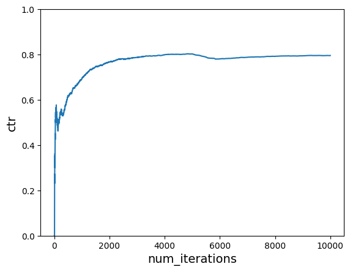

Vowpal Wabbit, BSD-3-Clause. [Changing user preferences](https://vowpalwabbit.org/docs/vowpal_wabbit/python/latest/tutorials/python_Simulating_a_news_personalization_scenario_using_Contextual_Bandits.html)


### Если устойчивого распределения награды вообще не предполагают

В **состязательной постановке** последовательность наград может меняться без стационарного вероятностного закона. Один из методов — EXP3. Он хранит положительный вес $w_a$ у каждой руки, смешивает распределение по весам с равномерным исследованием и увеличивает вес выбранной руки пропорционально оценке её награды. Начальные веса всех рук равны единице.

Для наград из $[0,1]$ и параметра $0\lt \gamma\lt 1$ один из стандартных вариантов записывается так. Здесь $\gamma$ управляет исследованием, а в начале главы той же буквой обозначался коэффициент дисконтирования в RL.

```math
p_t(a)=(1-\gamma)\frac{w_a}{\sum_b w_b}+\frac{\gamma}{K},
\qquad
\widehat r_t(a)=\frac{\mathbf 1\{A_t=a\}R_t}{p_t(a)},
\qquad
w_a\gets w_a e^{\gamma\widehat r_t(a)/K}.
```

Деление на $p_t(a)$ компенсирует то, что редкую руку наблюдают редко. Если при фиксированной истории награда руки равна $r_t(a)$, ожидание оценки равно $p_t(a)r_t(a)/p_t(a)=r_t(a)$. Похожее взвешивание появится при оценке политики по логам.

EXP3 сравнивает себя с лучшей фиксированной рукой за весь горизонт при стандартных условиях состязательной задачи. Если лучший вариант меняется каждую неделю, такое сравнение отличается от эталона, который тоже переключает руки. Для него нужны дополнительные предположения и алгоритмы.

### Если нужно выбрать несколько действий

При выборе одного предложения награду связывают с одной рукой. При выборе нескольких товаров или каналов действие становится набором. Так возникает **комбинаторный бандит**. Если наблюдаются отдельные отклики на каждый элемент набора, обратную связь называют **полубандитной**, semi-bandit.

Если пользователь видит упорядоченный список, позиция влияет на просмотр и покупку. В **каскадной модели** предполагают просмотр сверху вниз до первого подходящего элемента. Непросмотренный элемент после раннего клика не даёт наблюдения об отказе. В более общей задаче выбора списка, slate bandit, важны также взаимодействия элементов. Сумма независимых оценок товаров может не отражать награду всего списка.

Переход к наборам требует явно определить, какие части отклика наблюдаются и какие зависимости между элементами предполагаются.


## Как награда связана с коммерческой целью

### Покупка, маржа и цена контакта

Конверсия удобна для бинарной модели, но у предложений могут различаться маржа и стоимость. Пусть $Y_t$ — факт покупки, $M(a)$ — маржа при покупке предложения $a$, а $C(a)$ — стоимость контакта. Тогда можно задать награду

```math
R_t=Y_tM(A_t)-C(A_t).
```

Если предложение приносит 100 рублей с вероятностью $0.10$, а контакт стоит 2 рубля, ожидаемая награда равна $0.10\cdot100-2=8$ рублей. У более конверсионного, но дешёвого продукта она может быть ниже.

Методы для ограниченной награды требуют заранее выбранного диапазона или другой модели шума. Если денежные значения бывают большими выбросами, перенос гарантий UCB1 для $[0,1]$ требует обоснования. При ограничении награды сверху меняется и оптимизируемая величина.

### Действие «не контактировать» и дополнительный эффект

Клиент может совершить покупку сам. Полезно включить действие $a=0$, которое означает отсутствие контакта. При этом его награда должна измеряться в том же окне и по сопоставимой экономической метрике, что и для остальных действий.

Пусть $\mu(x,a)$ — ожидаемая маржа до цены контакта. **Дополнительный эффект**, uplift, предложения относительно отсутствия контакта равен

```math
\tau(x,a)=\mu(x,a)-\mu(x,0).
```

Предположим, клиент без сообщения покупает с вероятностью $0.30$, а после сообщения — с вероятностью $0.31$. Другая группа имеет вероятности $0.02$ и $0.08$. При равной марже первая группа привлекательнее по прогнозу покупки, вторая — по приросту от воздействия.

Здесь мы уточнили определение $\mu$, отделив цену контакта. Чистый дополнительный результат равен $\tau(x,a)-C(a)$. Если базовая награда $\mu(x,0)$ одинакова для сравниваемых действий при данном $x$, то максимизация ожидаемой чистой награды и её прироста относительно контроля даёт одинаковый порядок действий. Однако для измерения самого прироста базовую награду всё равно нужно оценить.

Для причинной интерпретации нужна сопоставимость групп действий. Если прежняя политика отправляла предложение только самым активным клиентам, высокая покупаемость среди получивших его ещё не устанавливает эффект сообщения. Рандомизация внутри допустимых действий даёт способ оценить этот эффект. Для клиента всё равно наблюдается лишь одно потенциальное следствие.

### Бюджеты и лимиты

До выбора формируют допустимое множество $\mathcal A_t(x)$. Из него исключают предложения, которые недоступны клиенту, контакты без согласия, исчерпанные продукты и каналы с нарушенным лимитом частоты.

Если цена отправки $c_t(A_t)$ расходует общий бюджет $B$, суммарный расход ограничен следующим условием.

```math
\sum_{t=1}^{T}c_t(A_t)\le B.
```

Возникает задача **бандита с ресурсными ограничениями**, bandits with knapsacks. Сегодняшнее расходование бюджета уменьшает число будущих решений.

В качестве приближённого правила можно сравнивать оценку награды за вычетом $\lambda_t c_t(a)$, где $\lambda_t$ — текущая цена дефицитного ресурса. Чем сильнее расход опережает план, тем выше эту цену поднимают. Для жёсткого соблюдения бюджета нужна отдельная проверка доступного остатка перед отправкой.

Сортировка только по отношению прибыли к цене может пропустить самое выгодное распределение бюджета. Если ресурс общий, решения разных клиентов становятся связанными.


## Как учитывать отклики, которые приходят позже

Пусть награда — покупка в течение семи дней после отправки. Между действием и итогом есть **задержка обратной связи**. В момент отправки награда неизвестна, через сутки она всё ещё может быть неизвестна, а после истечения окна можно зафиксировать отсутствие покупки.

Если все незавершённые окна немедленно записывать как нули, быстрые каналы будут выглядеть лучше медленных. Особенно сильно это смещает сравнение, если распределения задержек различаются между руками.

Для каждого решения хранят время действия, срок завершения окна и статус награды. Наблюдение может быть незавершённым, завершённым с успехом или завершённым без успеха. Политика может обновляться пакетно, например ежедневно, по одинаково созревшим наблюдениям.

Само число отправок и число завершённых откликов различаются. Для бета-модели счётчики успехов и неудач обновляют после определения результата. Если положительные отклики доступны раньше отрицательных, обучение только на уже пришедших событиях тоже временно завышает конверсию. Согласованное окно созревания упрощает начальную реализацию.

Если клиент получает несколько воздействий за одно окно, покупку нельзя автоматически приписать каждому из них. Нужны правила атрибуции, разнесение контактов или экспериментальная конструкция, позволяющая разделять эффекты.


На графике из эксперимента Calvera сравниваются разные размеры пакета обратной связи. Между обновлениями алгоритм принимает решения по одним и тем же оценкам. По горизонтали идёт число обработанных примеров, по вертикали — накопленное сожаление. Здесь задержка задаётся пакетами откликов, а в примере с коммуникациями — календарным окном.

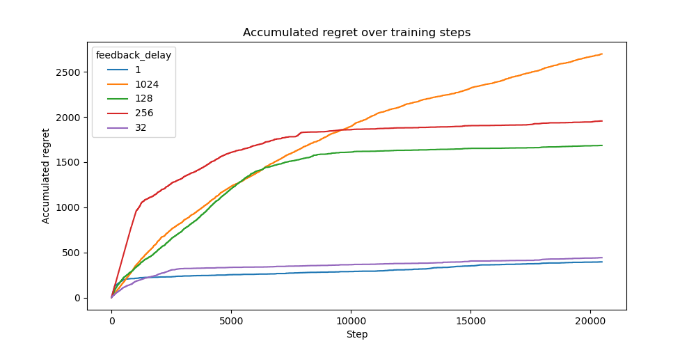

Готовый результат эксперимента разработчиков Calvera. [Условия и легенда](https://neural-bandits.github.io/calvera/benchmark_results_delayed_feedback/)


## Что должно попасть в журнал решений

Для последующей проверки и оценки по истории требуется восстановить, что было известно до действия и как именно оно выбиралось. Сохранённая вероятность покупки этой задачи не решает. Нужна вероятность **выбора действия**.

Минимальная запись содержит следующие поля.

- Идентификатор решения и клиента, время выбора и версию политики.
- Контекст на момент решения, версию признаков и список допустимых действий.
- Выбранное действие, итоговую вероятность его выбора и параметры случайного распределения.
- Факт исполнения действия, время доставки, завершение окна и полученную награду.
- Версию модели награды и сведения, позволяющие отделить тестовую группу от контрольной.

Вероятность выбора действия в логирующей политике называют **propensity**, склонностью к назначению. Её записывают как $p_i=b(a_i\mid x_i)$, где $b$ — политика, собиравшая историю. Для адаптивной политики она зависит также от истории до события, и в логе сохраняют вероятность при фактическом состоянии алгоритма.

Если ε-greedy сначала вычисляет вероятности, а затем ещё один фильтр отменяет часть действий или заменяет их, распределение фактически исполненных действий меняется. Для оценки требуется согласовать, что именно считается действием и к какому событию относится вероятность.

Предсказанная конверсия $0.12$ и вероятность выбора предложения $0.90$ описывают разные случайные события. При оценке по логам делить нужно на вторую.


## Как оценить новую политику по старым данным

### Почему среднего отклика по подходящим строкам недостаточно

Хотим оценить фиксированную политику $\pi$ до запуска. В истории есть $n$ записей $(x_i,a_i,r_i,p_i)$, собранных политикой $b$. **Офлайн-оценкой политики**, off-policy evaluation или OPE, называют оценку её ценности по таким данным.

Предположим, что контекст включает информацию, по которой назначалось действие, награда определена одинаково, а новая политика не меняет распределение поступающих контекстов. Для причинного переноса дополнительно нужна условная независимость потенциальных наград от выбора действия при заданных наблюдаемых условиях назначения. При корректной рандомизации она обеспечивается механизмом выбора.

Нужно также **покрытие**, overlap. В каждом контексте действие, которое новая политика может выбрать, должно иметь ненулевую вероятность в исторической политике.

```math
\pi(a\mid x)>0\ \Longrightarrow\ b(a\mid x)>0.
```

При детерминированной истории часть действий вообще не наблюдалась в соответствующих контекстах. Их результат можно предположить моделью, но восстановить из этой истории без дополнительных допущений нельзя.

### Оценка через модель награды

**Прямой метод**, direct method или DM, обучает $\widehat\mu(x,a)$ и усредняет её прогноз под новой политикой. Усреднение по историческим контекстам приближает среднее по целевой популяции.

```math
\widehat V_{\mathrm{DM}}(\pi)
=\frac1n\sum_{i=1}^{n}\sum_a\pi(a\mid x_i)\widehat\mu(x_i,a).
```

Для каждого клиента модель предсказывает награду каждого действия. Ошибки на редко назначавшихся действиях сразу переходят в ошибку оценки политики. Высокая AUC на часто показанных действиях этого не исключает.

### Вывод оценки с обратными вероятностями

**Inverse Propensity Scoring**, IPS, умножает полученные награды на поправочные веса. Пусть временно контекст $x$ фиксирован. В истории действие выбирается по $b(a\mid x)$, а мы хотим усреднить по $\pi(a\mid x)$.

Умножим награду выбранного действия на отношение этих вероятностей. Ожидание сначала берём по действию исторической политики и награде при этом действии.

```math
\mathbb E_{A\sim b,\ R\mid x,A}
\left[\frac{\pi(A\mid x)}{b(A\mid x)}R\right]
=\sum_a b(a\mid x)\frac{\pi(a\mid x)}{b(a\mid x)}\mu(x,a)
=\sum_a\pi(a\mid x)\mu(x,a).
```

Слагаемые $b(a\mid x)$ сократились. Теперь усредняем по $X$ и получаем $V(\pi)$. Выборочный аналог имеет вид

```math
w_i=\frac{\pi(a_i\mid x_i)}{p_i},
\qquad
\widehat V_{\mathrm{IPS}}(\pi)=\frac1n\sum_{i=1}^{n}w_i r_i.
```

Рассмотрим четыре независимых решения без контекста. Историческая политика выбирала A с вероятностью $1/2$. Записаны действия A, B, A, B и награды 1, 1, 0, 0. Новая политика всегда выбирает A. Веса равны 2, 0, 2, 0. Оценка IPS равна $(2\cdot1+0+2\cdot0+0)/4=0.5$.

Если действие назначалось с вероятностью $0.01$, а новая политика назначает его всегда, одна награда получает вес $100$. IPS с корректными вероятностями несмещённа для фиксированной оцениваемой политики при перечисленных условиях, но дисперсия может быть огромной. Для ненормированной IPS возможна оценка выше максимальной награды в конкретной выборке.

### Как снизить влияние больших весов

В **самонормированной IPS**, SNIPS, взвешенную сумму наград делят на сумму весов вместо $n$.

```math
\widehat V_{\mathrm{SNIPS}}
=\frac{\sum_iw_i r_i}{\sum_iw_i}.
```

При положительном знаменателе и бинарной награде оценка лежит в $[0,1]$. Она обычно имеет более удобный масштаб, но в конечной выборке появляется смещение. Если сумма весов равна нулю, эти логи не дали подходящих событий для такой оценки.

В другом варианте ограничивают каждый вес сверху порогом $c$. Это **обрезка весов**, clipping. Она уменьшает вклад редких событий, но нарушает точное сокращение вероятностей в выводе IPS. Вместе с результатом проверяют чувствительность к $c$.

Полезно также считать эффективный размер выборки, ESS. Он показывает, насколько неравномерно распределён вклад наблюдений.

```math
n_{\mathrm{eff}}=\frac{(\sum_iw_i)^2}{\sum_iw_i^2}.
```

При равных ненулевых весах ESS совпадает с количеством таких наблюдений. Если почти вся сумма приходится на один вес, ESS приближается к единице. Тысячи строк сами по себе не гарантируют устойчивой оценки.

### Как объединить прогноз и поправку по наблюдениям

**Дважды устойчивая оценка**, doubly robust или DR, начинает с DM и добавляет взвешенный остаток полученной награды.

```math
\widehat V_{\mathrm{DR}}(\pi)
=\frac1n\sum_{i=1}^{n}
\left[
\sum_a\pi(a\mid x_i)\widehat\mu(x_i,a)
+\frac{\pi(a_i\mid x_i)}{p_i}
\bigl(r_i-\widehat\mu(x_i,a_i)\bigr)
\right].
```

При корректной propensity и фиксированной модели награды условное ожидание поправки в контексте $x$ равно

```math
\mathbb E_b\left[
\frac{\pi(A\mid x)}{b(A\mid x)}
(R-\widehat\mu(x,A))\mid x
\right]
=\sum_a\pi(a\mid x)(\mu(x,a)-\widehat\mu(x,a)).
```

Складываем прогнозную часть с ожидаемой поправкой. Прогнозы модели сокращаются, и остаётся истинная средняя награда новой политики в контексте $x$.

```math
\sum_a\pi(a\mid x)\widehat\mu(x,a)
+\sum_a\pi(a\mid x)\bigl(\mu(x,a)-\widehat\mu(x,a)\bigr)
=\sum_a\pi(a\mid x)\mu(x,a).
```

Так правильные вероятности компенсируют ошибку модели. Если сама модель награды точна, остаток имеет нулевое условное среднее, даже при ошибке в модели propensity, если веса определены и выполнены остальные условия. Отсюда название.

На том же примере из четырёх строк пусть прогноз для A равен $0.4$. Для новой политики, всегда выбирающей A, DM равен $0.4$. Поправки по четырём строкам равны $2(1-0.4)$, $0$, $2(0-0.4)$, $0$. Их среднее равно $0.1$. DR даёт $0.5$.

Модель награды оценивают вне тех строк, на которых считают остатки. Для этого используют отдельную обучающую часть или перекрёстное обучение, cross-fitting. Во втором случае данные делят на блоки, каждый блок оценивают моделью, обученной на остальных, затем собирают прогнозы всех блоков.

На готовом примере Open Bandit Pipeline одной политике соответствуют три оценки. IPW — используемое авторами название взвешивания обратными вероятностями, в тексте главы это IPS. Чёрные отрезки показывают 95%-ные доверительные интервалы. Разница столбцов показывает, почему результат стоит проверять несколькими оценками.

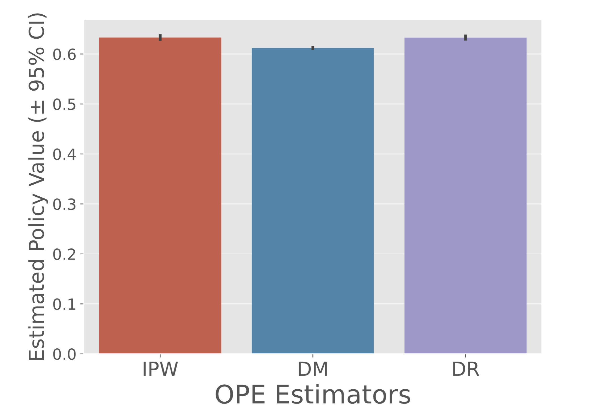

Open Bandit Pipeline, Apache-2.0. [Исходный пример](https://github.com/st-tech/zr-obp)


### Как разделить обучение и оценку

Если перебрать много политик и выбрать лучшую по одной и той же оценочной выборке, результат выбранной политики будет оптимистичным. Политику и её гиперпараметры подбирают на обучающей и валидационной части, итоговую ценность оценивают отдельно.

При независимых клиентах для доверительного интервала можно применять бутстрэп по клиентам. При повторных контактах нужно сохранять связанные наблюдения одного клиента вместе. При временных зависимостях и адаптивном назначении нужны способы оценки неопределённости, учитывающие эти зависимости.

Формулы выше оценивают фиксированную политику на распределении контекстов логов. Качество целого алгоритма, который после каждого решения изменяет себя, требует воспроизведения его обучения. В методе **replay** на равномерно рандомизированных логах алгоритм обновляют только на событиях, где его выбор совпал с историческим. При подходящих предположениях о независимом потоке и рандомизации совпавшие события имитируют его взаимодействие со средой. Данных при этом становится существенно меньше.


## Как проверить алгоритм до запуска

В симуляции распределения наград известны. Поэтому можно измерить и полученную награду, и сожаление относительно известного эталона. Для начала достаточно двух или трёх бернуллиевских рук, затем добавляют группы клиентов, дрейф и задержки.

Один запуск может случайно оказаться удачным. Для сравнения политик повторяют эксперимент с разными генераторами случайных чисел и показывают среднюю накопленную награду и разброс результатов. Отдельно считают доли действий. Если алгоритм никогда не выбирает одну руку, нужно проверить, связано ли это с данными, начальной логикой или ошибкой реализации.

Ниже показана последовательность одного решения. Вероятности фиксируются после проверки допустимости действий. Отложенный отклик возвращается в обучение через тот же идентификатор решения.

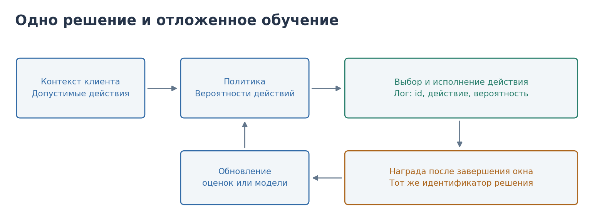

После симуляции проверяют сервис на исторических данных, расчёт вероятностей, соединение решений с откликами и поведение при недоступных предложениях. Первое применение на реальном потоке ограничивают по объёму и сравнивают с заранее определённым базовым правилом.

**Контрольная группа** получает базовую политику или отсутствие контакта. Распределение в экспериментальные группы выполняют отдельно от внутренних исследований бандита. При повторных контактах назначение на уровне клиента помогает сохранять сопоставимость групп во времени.

В обычном **A/B-тесте** клиентов случайно делят между двумя вариантами, а доли групп обычно задают заранее. Цель такого эксперимента — оценить различие результатов при установленной процедуре сравнения. Бандит меняет доли действий по мере накопления откликов, стараясь получать больше награды уже во время обучения. Поэтому внешним A/B-тестом можно сравнить целую адаптивную политику с прежним правилом. Внутри экспериментальной группы бандит продолжает самостоятельно выбирать предложения.

В отчёте нужны средняя экономическая награда на клиента, дополнительный эффект относительно контроля, расходы, доли действий и ограничения качества обслуживания. Кроме покупок отслеживают жалобы, отписки и частоту контактов. Эти величины могут выступать ограничениями даже тогда, когда в награду входит только маржа.

Результаты бандита внутри его собственного адаптивного трафика и результат внешнего эксперимента отвечают на разные вопросы. При частом просмотре промежуточных результатов обычные фиксированные доверительные интервалы требуют осторожного применения. Правило остановки эксперимента задают вместе с процедурой проверки.


## Как собрать постановку из прикладной задачи

Пусть есть поток клиентов, два предложения и возможность ничего не отправлять. Начнём с определения одного решения. Оно относится к одному клиенту в определённый момент времени, а награда измеряет маржу за семь дней за вычетом цены выбранного контакта.

Далее определим действия $0$, A и B и правила допустимости. Отсутствие согласия оставляет только $0$. Наличие уже купленного продукта исключает соответствующее предложение. Частотный лимит проверяется по предыдущим контактам.

Затем фиксируем контекст. В него входят только известные до выбора признаки клиента, времени и предложений. Разные клиенты могут получать разные действия при одинаковой модели. Поскольку требуется переносить знания между решениями, выбираем контекстную постановку.

В первом варианте обучим модель ожидаемой награды и добавим ε-greedy с вероятностью исследования $0.10$. Для клиента, которому доступны три действия и для которого основная ветвь выбрала A, вероятности равны $0.9333$ для A и примерно $0.0333$ для каждого другого действия. Если B недоступно, распределение пересчитывается по двум оставшимся действиям. В этом случае A получает $0.95$, а $0$ — $0.05$.

Каждое решение записывается вместе с итоговой вероятностью. Новые данные поступают в обучение после одинакового семидневного окна. Логи делятся по времени, а модель награды и новая политика оцениваются на данных вне своего обучения. Для фиксированной кандидатной политики считаем DM, IPS и DR, проверяем большие веса и покрытие.

Наконец, сравниваем кандидатную политику с базовым правилом во внешнем эксперименте. При ограниченном бюджете дополнительно проверяем расход и долю отклонённых действий. Если оказывается, что контакт существенно меняет многомесячную траекторию клиента, возвращаемся к последовательной постановке и определению возврата из начала главы.


Схема Open Bandit Pipeline показывает место каждого этапа. Сначала собирают данные, затем обучают политику, после этого оценивают её по логам. Последний блок — проверка точности самого метода OPE на задачах с доступным эталоном. Он особенно полезен в симуляциях, где известна истинная ценность политики.

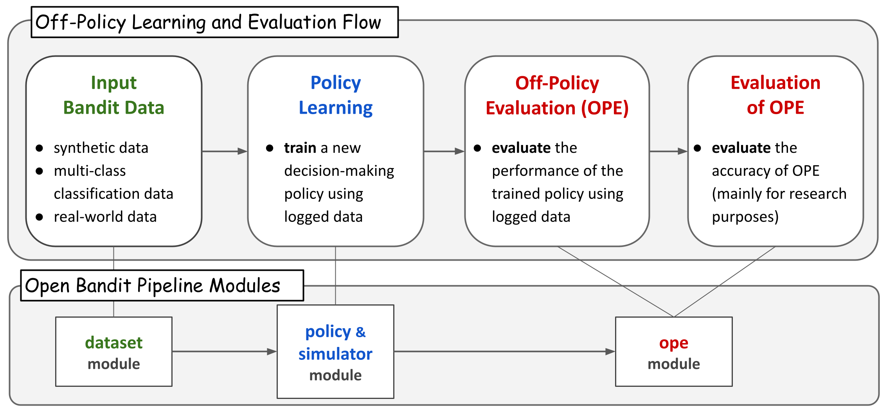

Open Bandit Pipeline, Apache-2.0. [Источник схемы](https://github.com/st-tech/zr-obp)


## Задачи для самостоятельной проверки

1. У A было 3 успеха в 50 выборах, у B — 1 в 10. Начальные распределения обеих рук равны $\mathrm{Beta}(1,1)$. Выпишите распределения после наблюдений и их средние. Объясните, почему Thompson Sampling не обязан каждый раз выбирать руку с большим средним.
2. В ε-greedy есть четыре допустимых действия и $\varepsilon=0.20$. Посчитайте вероятность лучшего и каждого другого действия. Затем исключите одно действие и пересчитайте вероятности.
3. У двух рук одинаковая оценка награды. Первая наблюдалась 25 раз, вторая — 100. Во сколько раз отличаются бонусы UCB при одном и том же $t$?
4. Новая политика всегда выбирает A. В логе из трёх строк действия A, B, A, награды 1, 0, 0, вероятности исторического выбора $0.2$, $0.7$, $0.5$. Вычислите IPS, SNIPS и ESS.
5. Историческая политика ни разу не показывала B некоторой группе клиентов. Какие из методов оценки могут дать прогноз для новой политики, которая показывает ей B? За счёт какого предположения появляется этот прогноз?
6. Две недели одна рука лидировала, затем её конверсия упала вдвое. Опишите, как изменятся оценки полного среднего и среднего по окну.
7. Награду измеряют покупкой за семь дней, но первые покупки приходят через час. Что произойдёт, если обучать модель на всех пришедших покупках и только завершившихся отрицательных окнах?

Для первой задачи получаются $\mathrm{Beta}(4,48)$ и $\mathrm{Beta}(2,10)$ со средними примерно $0.077$ и $0.167$. Во второй вероятности равны $0.85$ и $0.05$, а после исключения — примерно $0.8667$ и $0.0667$. В третьей бонус первой руки вдвое больше. В четвёртой веса равны $5$, $0$, $2$, поэтому IPS равна $5/3$, SNIPS равна $5/7$, ESS равен $49/29\approx1.69$.

В пятой задаче прямой метод может выдать прогноз, полагаясь на перенос модели в непокрытую область. Для идентификации ценности по IPS покрытия не хватает. В шестой полное среднее долго смешивает старый и новый режимы, а оконное постепенно удаляет старые наблюдения. В седьмой среди незрелых решений учтены только успехи, поэтому конверсия временно завышается.


## Источники

Базовую связь с RL и обозначения ценности можно сверить по Sutton и Barto. Для алгоритмов и оценки политики ниже приведены первичные статьи и учебники.

- Sutton, Barto. *Reinforcement Learning: An Introduction*. Второе издание, 2018. Главы 2–3 о бандитах и конечных MDP. [Сайт книги](http://incompleteideas.net/book/the-book-2nd.html)
- Lattimore, Szepesvári. *Bandit Algorithms*, 2020. Стохастические, контекстные и состязательные постановки. [Книга](https://tor-lattimore.com/downloads/book/book.pdf)
- Auer, Cesa-Bianchi, Fischer. *Finite-time Analysis of the Multiarmed Bandit Problem*, 2002. Анализ UCB1. [Статья](https://homes.di.unimi.it/~cesabian/Pubblicazioni/ml-02.pdf)
- Russo и др. *A Tutorial on Thompson Sampling*, 2018. Байесовский выбор действий. [Статья](https://arxiv.org/abs/1707.02038)
- Li и др. *A Contextual-Bandit Approach to Personalized News Article Recommendation*, 2010. LinUCB и персонализация. [Статья](https://arxiv.org/abs/1003.0146)
- Li и др. *Unbiased Offline Evaluation of Contextual-bandit-based News Article Recommendation Algorithms*, 2011. Оценка через replay. [Статья](https://arxiv.org/abs/1003.5956)
- Dudík, Langford, Li. *Doubly Robust Policy Evaluation and Learning*, 2011. Оценка DR. [Статья](https://arxiv.org/abs/1103.4601)
- Garivier, Moulines. *On Upper-Confidence Bound Policies for Non-Stationary Bandit Problems*. Скользящее окно и забывание. [Статья](https://arxiv.org/abs/0805.3415)
- Badanidiyuru, Kleinberg, Slivkins. *Bandits with Knapsacks*. Ресурсные ограничения. [Статья](https://arxiv.org/abs/1305.2545)
