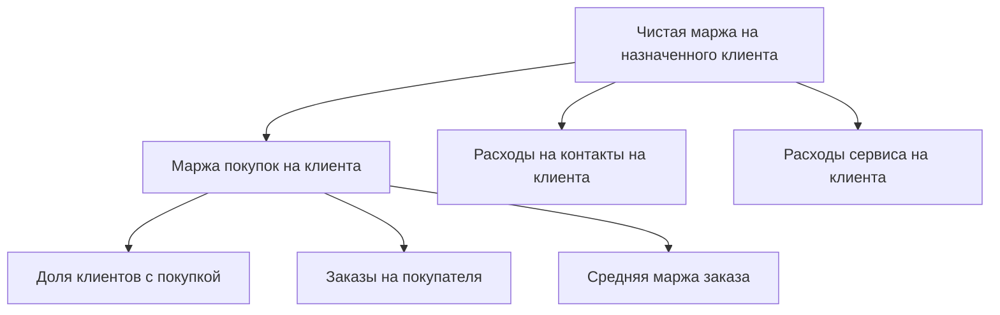

# 10. Метрики — от бизнес-результата до качества данных

AI-система может повысить точность прогноза, увеличить клики и одновременно уменьшить прибыль. Например, модель начинает чаще выбирать привлекательные предложения с большой скидкой. Поэтому качество проекта нужно описывать несколькими связанными показателями.

**Метрика** — числовое правило измерения выбранного свойства. «Клиенты стали активнее» — утверждение, которое ещё нужно определить. «Доля назначенных в эксперимент клиентов, совершивших покупку за 14 дней» — метрика с понятными единицей анализа, знаменателем и окном.


## Уровни и роли метрик

Уровень показывает, какую часть системы мы измеряем. Роль показывает, зачем показатель используется при принятии решения. Это два разных признака. Например, задержка сервиса относится к техническому уровню, а в эксперименте может быть защитной метрикой.

| Уровень | Вопрос | Примеры в CVM |
| --- | --- | --- |
| Бизнес | Изменился ли экономический результат? | Дополнительная маржа, расходы, удержание прибыльных клиентов |
| Клиентское поведение и продукт | Что клиент сделал после взаимодействия? | Покупка, повторная покупка, отказ от коммуникаций |
| Качество модели | Насколько полезен прогноз для выбора действия? | PR-AUC, LogLoss, калибровка, качество верхнего сегмента |
| Работа сервиса | Доступно ли решение вовремя и по приемлемой цене? | p95 задержки, ошибки, стоимость решения, частота резервного ответа |
| Данные | Можно ли доверять входам и измерению результата? | Полнота событий, свежесть признаков, дубли, пропуски |

В небольшой задаче список может состоять из одной главной метрики, двух защитных и нескольких диагностических. Сначала выбирают решение, которое нужно принять, затем показатели для этого решения.


## Определение и паспорт метрики

У метрики должен быть краткий паспорт. Он позволяет двум аналитикам независимо получить один результат.

| Поле | Пример |
| --- | --- |
| Название и смысл | Чистая маржа на клиента после назначения в эксперимент |
| Единица анализа | Уникальный клиент |
| Числитель | Маржа покупок минус согласованные затраты |
| Знаменатель | Все назначенные клиенты соответствующего варианта |
| Окно | 14 суток с момента назначения |
| Включения и исключения | Правила по отменам, возвратам и сотрудникам |
| Созревание | Итог после завершения окна и задержки поступления событий |
| Источник | Таблицы назначений, покупок, возвратов и контактов |
| Владелец | Ответственный за определение и изменения расчёта |

Нужно также зафиксировать версию расчёта. Если из одной версии исключают возвраты, а из другой включают, сравнение отражает и это изменение.

Для средних и долей указывают численность и неопределённость. Разница между конверсиями 10% и 11% имеет разный вес при сотне и при ста тысячах клиентов. В эксперименте добавляют доверительный интервал эффекта, как в главе 9.


## Бизнес-метрики и экономика клиента

Выручка — деньги от продаж до вычитания расходов. Для расчёта маржи фиксируют состав выручки и затрат. Если выручка уже отражает цену со скидкой и возвраты, из неё вычитают только согласованные переменные затраты на продукт. Повторно вычитать скидку из такой выручки не нужно. Отдельно учитывают контакт и вычислительную инфраструктуру.

Пусть $M_i$ — маржа покупок клиента $i$ в выбранном окне, $C_i$ — расходы на контакты, $S_i$ — переменные расходы сервиса. Для N назначенных клиентов средний чистый результат на клиента равен

```math
\overline\Pi=
\frac{1}{N}\displaystyle\sum\limits_{i=1}^{N}(M_i-C_i-S_i).
```

Клиент без покупки тоже входит в знаменатель. Его маржа покупок может быть нулевой, а расходы — положительными. Это позволяет учесть цену неудачных коммуникаций.

В A/B-тесте оцениваем дополнительный результат нового решения относительно контроля. При одинаковых определениях в двух группах

```math
\widehat\tau_\Pi=\overline\Pi_B-\overline\Pi_A.
```

Для планирования на $N_{\mathrm{target}}$ сопоставимых клиентов ожидаемый дополнительный результат приближённо равен произведению размера аудитории и эффекта на клиента. Если фиксированные расходы на разработку $C_{\mathrm{dev}}$ ещё не включены в клиентские затраты, учитываем их отдельно.

```math
\widehat{\Delta\Pi}_{\mathrm{total}}
=N_{\mathrm{target}}\widehat\tau_\Pi-C_{\mathrm{dev}}.
```

Такое масштабирование предполагает сопоставимость аудитории и условий. При ограниченном бюджете, изменении состава клиентов или насыщении канала эффект может измениться. Одни и те же расходы учитывают в расчёте один раз.

### Удержание, отток и ценность клиента

**Удержание**, retention, показывает, какая доля выбранной когорты продолжила целевое поведение к заданному сроку. Когорта — группа, объединённая исходным событием, например покупкой в определённом месяце. Нужно определить, что означает «продолжила» — хотя бы одна покупка в следующем месяце или отсутствие закрытия продукта.

**Отток**, churn, — заранее определённое событие прекращения отношений или активности. Для месячной доли оттока в знаменателе обычно берут клиентов, которые могли уйти в начале периода. Связь между churn и retention зависит от правил измерения и возврата клиента.

**Ценность клиента за горизонт**, CLV, учитывает будущие результаты. Пусть $\Pi_{i,t}$ — чистый результат клиента в период $t$, $H$ — число периодов, а $d$ — ставка дисконтирования за период. Тогда прогнозная ценность имеет вид

```math
\mathrm{CLV}_i=
\displaystyle\sum\limits_{t=1}^{H}
\frac{\mathbb E[\Pi_{i,t}]}{(1+d)^t}.
```

CLV расшифровывается как Customer Lifetime Value, ценность за время отношений с клиентом. Приведённая формула ограничивает прогноз горизонтом H. Ожидание берётся по возможным будущим покупкам, оттоку и затратам при доступной на дату прогноза информации о клиенте. Дисконтирование переводит будущие деньги в стоимость на дату оценки, причём ставка d должна соответствовать длительности периода t. Если проект обещает прирост CLV, в коротком эксперименте его обычно проверяют через измеримые промежуточные результаты и последующее наблюдение более долгой когорты.


## Дерево метрик

**Дерево метрик** связывает итоговую цель с показателями, на которые команда может воздействовать. Начнём с чистой маржи на назначенного клиента. В выбранном окне маржу покупок можно точно разложить на долю покупателей, среднее число заказов на покупателя и среднюю маржу заказа.

```math
\frac{\text{маржа покупок}}{\text{клиенты}}
=
\frac{\text{покупатели}}{\text{клиенты}}
\cdot
\frac{\text{заказы}}{\text{покупатели}}
\cdot
\frac{\text{маржа покупок}}{\text{заказы}}.
```

При единой аудитории и окне промежуточные числители и знаменатели сокращаются. Для ненулевых знаменателей это арифметическое тождество. Добавим расходы и получим дерево.



Верхний показатель равен G − C − S, а G равен B × O × M. Например, при конверсии 0.10, одном заказе на покупателя и марже 200 рублей получаем 20 рублей маржи покупок на клиента. Если контакт стоит 2 рубля, а сервис — 0.5 рубля, чистый результат равен 17.5 рубля. Если конверсия выросла до 0.12, но маржа заказа из-за скидки упала до 150 рублей, получаем только 15.5 рубля чистого результата при тех же расходах.

Покупателей, заказы и маржу нужно считать по одной популяции. Если конверсия рассчитана среди получивших сообщение, а расходы разделены на всех назначенных клиентов, сокращение уже не работает без дополнительных множителей.

### Арифметические и причинные связи

В дереве выше связи арифметические. Связь «PR-AUC модели выросла, значит конверсия вырастет» — гипотеза о поведении системы. Её проверяют после внедрения конкретного правила выбора.

Полезно различать два типа связей в рабочем дереве. Для арифметической связи записывают формулу. Для предполагаемой причинной связи записывают обоснование и способ проверки. Например, уменьшение задержки может увеличить долю решений, успевших до отправки. Но величина этого изменения зависит от очередей и расписания коммуникаций.


## Прокси-метрики и ранние сигналы

**Прокси-метрика** заменяет более долгий, дорогой или пока недоступный результат. Например, клик можно использовать как ранний сигнал интереса, а покупку за семь дней — как ранний сигнал долгосрочной ценности.

Сначала формулируют, какую конечную метрику заменяет прокси и почему изменение прокси должно предсказывать полезное изменение этой метрики. Затем проверяют связь на истории и, когда возможно, по результатам экспериментов.

| Конечный результат | Возможная прокси | Где связь может нарушиться |
| --- | --- | --- |
| Дополнительная маржа | Покупка | Скидка увеличивает покупки и уменьшает маржу |
| Покупка | Клик | Любопытство или провокационный текст дают клики без покупок |
| Удержание прибыльных клиентов | Активность за неделю | Действия происходят ради бонуса и прекращаются после него |
| Полезность персонализации | Офлайн-качество ранжирования | Рекомендация не доходит до клиента или недоступна ему |

**Опережающий показатель**, leading indicator, помогает предсказывать будущий результат и даёт время повлиять на него. Например, устойчивое снижение активности может предшествовать оттоку. **Запаздывающий показатель**, lagging indicator, фиксирует уже состоявшийся результат, например отток за завершённый месяц. Для роли опережающего показателя нужна проверенная связь с будущим результатом. Одной ранней доступности события недостаточно.

Корреляции по отдельным клиентам недостаточно. Клиенты, которые больше кликают, могут больше покупать, но изменение текста способно увеличить только клики. Прокси проверяют по тому, сопровождается ли её изменение в экспериментах изменением конечного результата.


## Роли метрик в эксперименте

| Роль | Как участвует в решении | Пример |
| --- | --- | --- |
| Главная, primary | Определяет основной результат гипотезы | Чистая маржа на назначенного клиента |
| Защитная, guardrail | Ограничивает допустимый вред | Рост отписок не больше заданной границы |
| Диагностическая | Объясняет механизм изменения | Доставка, переход, покупка |
| Качество измерения | Показывает, можно ли доверять сравнению | SRM, полнота событий, повторные назначения |

Правило по главной метрике и ограничения задают до запуска. Например, рост маржи при недопустимом росте жалоб не удовлетворяет условиям внедрения. При этом p-value выше порога на жалобах ещё не доказывает отсутствие вреда. Нужно оценить интервал ухудшения относительно допустимой границы.

Если назначить главными десять показателей и объявлять успех по любому значимому улучшению, вероятность случайной победы возрастёт. При нескольких подтверждающих проверках планируют порядок решений и поправку на множественные сравнения.


## Технические метрики модели

Предположим, модель предсказывает вероятность покупки, а контактный бюджет позволяет выбрать только часть клиентов. Тогда важны и порядок клиентов, и качество вероятностей, и результат среди выбранных.

| Задача оценки | Метрики | Что уточнить |
| --- | --- | --- |
| Ранжировать покупателей выше остальных | ROC-AUC, PR-AUC | Частота положительного класса и состав тестовой выборки |
| Отобрать ограниченное число клиентов | Precision@k, Recall@k, Lift@k | Размер k, ограничения контакта и правило выбора |
| Оценить вероятность | LogLoss, Brier score, калибровка | Соответствие вероятностей фактическим долям |
| Прогнозировать сумму | MAE, RMSE | Денежная шкала, выбросы и сегменты |
| Выбрать воздействие | Ценность политики, дополнительный эффект | Наличие контроля, покрытие действий и метод оценки |

ROC-AUC, PR-AUC, LogLoss, MAE и MSE разобраны в главе 2. RMSE равна квадратному корню из MSE и выражается в тех же единицах, что и целевая величина. Brier score оценивает средний квадрат ошибки вероятности бинарного события. Если yᵢ — факт покупки, а pᵢ — прогноз, то

```math
\mathrm{Brier}=\frac{1}{n}\displaystyle\sum\limits_{i=1}^{n}(p_i-y_i)^2.
```

Для верхних k клиентов Precision@k — доля покупателей среди выбранных, Recall@k — доля всех покупателей выборки, попавших в этот сегмент. Эти определения предполагают, что исходы известны для всей оценочной выборки. При частичных откликах бандита применяют методы оценки политики из главы 8.

**Калибровка** означает, что среди объектов с прогнозом около 0.10 событие происходит примерно у 10%. Калиброванная вероятность нужна, когда выбор определяется ожидаемой выгодой от контакта. Для решения о контакте нужны вероятности покупки при контакте и без него. Обозначим их через $p_1$ и $p_0$, маржу покупки — через $M$, стоимость контакта — через $C$. При одинаковой марже покупки дополнительная ожидаемая выгода равна

```math
\Delta V=(p_1-p_0)M-C.
```

Контакт экономически оправдан при положительной дополнительной выгоде, если соблюдены остальные ограничения. Обычный прогноз покупки без оценки p₀ может отдавать приоритет клиентам, которые купили бы без обращения.

Метрика Lift@k сравнивает долю покупателей в верхних k позициях с долей покупателей во всей оценочной выборке.

```math
\mathrm{Lift@k}=
\frac{\mathrm{Precision@k}}{\text{доля покупателей в выборке}}.
```

Если среди всех клиентов покупают 5%, а в верхнем сегменте — 15%, Lift@k равен 3. Это оценка качества выделения покупателей на данной выборке. Для доказательства влияния сообщения на покупки нужен контроль назначения.

Различия в PR-AUC при разной частоте покупателей могут отражать состав данных. Поэтому версии модели сравнивают на согласованной выборке, по времени и при одинаковом определении целевой переменной. Рядом с общей метрикой проверяют ключевые сегменты.


## Метрики сервиса и данных

Даже полезная модель может редко участвовать в решениях. Например, данные приходят поздно, запрос не укладывается в срок и сервис возвращает резервное правило.

| Область | Метрика | Почему влияет на проект |
| --- | --- | --- |
| Время ответа | p50, p95, p99 задержки | Позволяет увидеть типичную задержку и хвосты |
| Доступность | Доля успешных запросов | Определяет, сколько решений вообще исполнено |
| Использование модели | Доля резервных ответов, fallback rate | Показывает, какая часть трафика обслужена другим правилом |
| Цена | Стоимость на 1 000 решений | Влияет на экономику масштабирования |
| Свежесть данных | Возраст признаков на момент решения | Запоздалые признаки меняют точность и доступность действий |
| Полнота результата | Доля решений с завершённой и связанной наградой | Определяет качество обучения и эксперимента |

Квантиль p95 задержки равен такому значению времени, не больше которого выполнено примерно 95% измеренных запросов. Нужно указать, что именно измеряется — вычисление модели или весь запрос с получением признаков. Средняя задержка может скрывать редкие долгие ответы.

**Дрейф данных** — изменение распределения признаков или целевой переменной. Его отслеживают по долям категорий, пропускам и распределениям числовых признаков. Сигнал дрейфа помогает найти изменение условий. Чтобы определить влияние на качество, дополнительно нужны отклики и показатели результата.

### Целевые показатели сервиса

Пусть известно, что решение должно быть готово до запуска отправки. Измерим долю запросов, укладывающихся в это время, и долю назначений, реально исполненных по модели. Если выросла точность, а почти все решения приходят после срока, ожидаемая польза ограничена.

Технический целевой уровень нужно связать с режимом работы. Для ночного пакетного расчёта может быть важнее завершение всего задания до установленного времени, чем миллисекунды на одном объекте. Для онлайн-запроса важнее хвост задержки и частота ошибок.


## Типы показателей и единицы анализа

Абсолютное число покупок зависит и от качества решения, и от размера аудитории. Доля покупок учитывает размер знаменателя, но может измениться при смене состава аудитории. Поэтому рядом с долей сохраняют её числитель и знаменатель.

Среднее отвечает за суммарный результат на единицу аудитории. Медиана описывает типичного клиента. Если большинство клиентов ничего не покупает, медианная маржа может оставаться нулевой при заметном изменении средней прибыли. Квантили нужны для хвостов расходов, задержек и клиентских результатов.

Метрики на клиента, на контакт и на заказ имеют разные знаменатели. Если система сократила число контактов, конверсия на контакт может вырасти при снижении общего числа покупок. Выбор знаменателя должен соответствовать цели решения.

**Входные показатели**, input metrics, описывают то, чем команда управляет непосредственно, например долю клиентов с актуальными признаками. **Выходные**, output metrics, описывают полученный результат, например покупки. Доля выполненных задач команды измеряет выполнение плана. Ценность изменения для клиента оценивают по клиентским и бизнес-результатам.


## Совместная интерпретация метрик

Пусть после внедрения ROC-AUC выросла, конверсия на доставленное сообщение выросла, а маржа на назначенного клиента снизилась. Последовательно проверим дерево.

Сначала сравним число назначенных клиентов и правила включения в расчёт. Затем посмотрим доли исполнения, доставки и резервных ответов. После этого сравним конверсию, среднее число заказов и маржу заказа. Эти показатели совместно определяют маржу покупок на клиента. Отдельно сравним затраты и защитные метрики.

Так можно обнаружить, что модель чаще выбирала дорогой канал или продукт с большой скидкой. Значение ROC-AUC при этом могло вырасти, поскольку модель лучше находила покупателей. Вывод по проекту зависит от результата всей политики на целевой аудитории.

В рабочем отчёте удобно сначала показать главную бизнес-метрику с эффектом и интервалом, затем защитные показатели, затем причины по дереву и состояние сервиса. Технические детали помогают объяснить результат и выбрать следующее действие команды.


## Источники

- Kohavi, Tang, Xu. *Trustworthy Online Controlled Experiments*, 2020. Выбор метрик и интерпретация экспериментов.
- Rodden, Hutchinson, Fu. *Measuring the User Experience on a Large Scale*, 2010. Связь целей, сигналов и метрик. [Исследование Google](https://research.google/pubs/measuring-the-user-experience-on-a-large-scale-user-centered-metrics-for-web-applications/)
- [Метрики классификации и регрессии в scikit-learn](https://scikit-learn.org/stable/modules/model_evaluation.html)
- [Калибровка вероятностей в scikit-learn](https://scikit-learn.org/stable/modules/calibration.html)
- [Мониторинг сервисов в Google SRE](https://sre.google/sre-book/monitoring-distributed-systems/)
